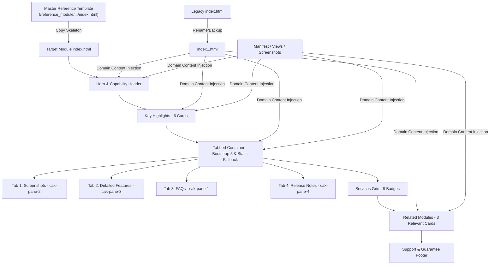

# Standard Operating Procedure & Implementation Plan: Updating Odoo Module `index.html` to the Latest Cybrosys Template

This document outlines the systematic, step-by-step implementation plan and architectural standards for migrating any legacy Odoo module description (`static/description/index.html`) to the latest **Cybrosys Odoo 20 Standard Description Template**.

---

## 1. Architectural Overview & Design System

The latest Cybrosys description layout is engineered specifically to **survive the Odoo Apps Store HTML sanitizer** while rendering cleanly across desktop browsers, mobile devices, and the internal Odoo Apps manager.

> [!IMPORTANT]
> **Canonical Master Template Source**:
> The official, authoritative reference structure for all Odoo 20 module descriptions is located at:
> - **Master Template File**: [`/home/cybrosys/odoo20/migration/reference_module/static/description/index.html`](file:///home/cybrosys/odoo20/migration/reference_module/static/description/index.html)
> - **Master Branded Icons**: [`/home/cybrosys/odoo20/migration/reference_module/static/description/assets/icons/`](file:///home/cybrosys/odoo20/migration/reference_module/static/description/assets/icons/)



### Core Design Rules & Constraints

1. **Table-Based Architecture with Percentage Widths**:
   - Layout relies on `<table>`, `<tr>`, and `<td>` with fixed percentage widths (`48%` + `4%` + `48%` or `32%` + `2%` + `32%` + `2%` + `32%`).
   - Card borders and background styling reside strictly on `<td>` elements to enforce equal row heights.
   - Internal padding resides on an inner `<div>` so mobile stacking rules (`.mob-stack`) cannot crush or flatten card spacing.
2. **Branded Color Palette**:
   - Primary Accent: `#b12126` (Cybrosys Red).
   - Light Tint Background: `#fdf3f4` / `#fdf2f2`.
   - Border Strokes: `#f1dcdf` / `#f3e4e5` / `#b221261f`.
   - Text Colors: `#0f172a` (Headings/Titles), `#64748b` / `#666666` (Body text), `#94a3b8` (Muted labels).
   - Permitted Exceptions: WhatsApp green (`#25d366` / `#2d7d32`) solely for WhatsApp contact chips and release badges.
3. **Typography**:
   - Headings & Badges: `'Plus Jakarta Sans', -apple-system, BlinkMacSystemFont, 'Segoe UI', Roboto, sans-serif`.
   - Body & Descriptions: `'Inter', -apple-system, BlinkMacSystemFont, 'Segoe UI', Roboto, sans-serif`.
4. **Resilience to Sanitization**:
   - No interactive `<form>` elements or hidden inputs.
   - Tabs use anchor tags `<a class="nav-link" data-bs-toggle="tab">` so they function dynamically with Bootstrap 5 on the web and degrade into stacked anchors in environments without JavaScript.
   - FAQs use static visible `Q` and `A` cards rather than collapsible accordions to ensure content is immediately readable if stylesheets or scripts are removed.

---

## 2. Source Data Extraction & Preparation (Pre-requisites)

Before modifying any HTML, gather the module's domain data:

| Component | Source File / Location | Data to Extract |
| :--- | :--- | :--- |
| **Master Skeleton** | `/home/cybrosys/odoo20/migration/reference_module/static/description/index.html` | Base HTML table structure, inline CSS, Bootstrap 5 tab wiring, and responsive layout. |
| **Master Icons** | `/home/cybrosys/odoo20/migration/reference_module/static/description/assets/icons/` | Standard Cybrosys vector chips (`ic-*.png`) for headers, highlights, services, and cards. |
| **Module Meta** | `__manifest__.py` | Display name, summary, category, license, version (`20.0.1.0.0`), dependencies (`depends`). |
| **Legacy Text** | `static/description/index1.html` | Prior features, workflows, and core user benefits. |
| **Actual Views** | `views/*.xml`, `models/*.py` | Real menus, button names, fields, smart buttons, actions, and wizards. |
| **Screenshots** | `static/description/assets/screenshots/` | Exact filenames, image resolutions, and operational stages represented. |

---

## 3. Step-by-Step Implementation Workflow

To prevent errors and ensure thorough quality control, follow this sequential execution order:

### Phase 1: Workspace Setup & Backup
1. **Preserve Legacy Content**:
   - Rename existing `static/description/index.html` to `static/description/index1.html`.
2. **Initialize New Template from Master Reference**:
   - Copy the master structure:
     ```bash
     cp /home/cybrosys/odoo20/migration/reference_module/static/description/index.html static/description/index.html
     ```
   - Ensure standard icons are present in the module:
     ```bash
     mkdir -p static/description/assets/icons
     cp /home/cybrosys/odoo20/migration/reference_module/static/description/assets/icons/* static/description/assets/icons/
     ```

---

### Phase 2: Page Metadata & Hero Section
1. **HTML `<head>`**:
   - Set `<title>` to `{Module Display Name} for Odoo 20`.
2. **Edition & Deployment Capability Rail**:
   - Verify badges for **Community** (Supported), **Enterprise** (Supported), **Odoo.sh** (Supported), **On-Premise** (Supported), and **Odoo Online** (Unsupported for modules with custom Python code).
3. **Hero Headline & Subtitle**:
   - `<h1>`: Display full module name with the last phrase highlighted in red: `<span style="color: #b12126;">for Odoo 20</span>`.
   - Subtitle `<p>`: Clear 2-sentence summary detailing business value, primary interface locations, and core automation.
   - Contact Buttons: Email (`odoo@cybrosys.com`) and WhatsApp (`+91 9074270811`).
4. **Minimal Bullet Checklist**:
   - 4 horizontal badge items highlighting key functional pillars (e.g. `Product Kanban View`, `Manufacturing Orders`, `Work Orders & BOM`, `Scrap & Unbuild Orders`).

---

### Phase 3: Key Highlights Grid (6 Cards)
The Key Highlights section consists of a `2 rows × 3 columns` table grid. Each card requires:
* **Icon Chip**: 48×48px container with `#b12126` background and centered white icon.
* **Heading (`<h3>`)**: Short, high-impact feature name (15–18px bold).
* **Divider**: `1px solid #f6eaea` with 14px margins.
* **Body Copy (`<p>`)**: Concise description explaining what the feature does in active voice.

**Content Rules**:
* Must reflect real module capabilities (no generic placeholders).
* Avoid "Allows to + verb"; use active, professional verbs: *"View comprehensive manufacturing details..."*, *"Directly access and inspect..."*, *"Automatically calculate and track..."*.

---

### Phase 4: Screenshots Tab (`cak-pane-2`)
1. **Inspect Physical Files**:
   - Check `static/description/assets/screenshots/` for real PNG/JPG images.
2. **Structure Each Item**:
   - Centered title with red emphasis span: `e.g. Products Kanban <span style="color: #b12126;">View</span>`.
   - Explanatory paragraph describing the user workflow shown in the image.
   - Image wrapper: `border-radius: 14px; overflow: hidden; border: 1px solid #b221261f;`.
   - Image tag: `style="width: 100%; display: block;"` with descriptive `alt` attribute.
3. **Match Progression**:
   - Order screenshots chronologically matching user experience: (1) Main View/Dashboard -> (2) Configuration/Actions -> (3) Execution/Counters -> (4) Drill-down/Reports.

---

### Phase 5: Feature Matrix / Detailed Features (`cak-pane-3`)
The Feature Matrix consists of a `3 rows × 2 columns` table grid featuring numbered badges (`01` through `06`).
* **Number Badge**: 44×44px square badge with `#b12126` background and white bold digits.
* **Feature Title**: 15px bold dark text (`#0f172a`).
* **Description**: Detailed explanation of technical or operational advantages.

**Verification Checklist**:
- [ ] Card 01: Primary View / Interface Mode
- [ ] Card 02: Real-time Metrics / Counters / Tracking
- [ ] Card 03: Action Menus / Direct Navigation
- [ ] Card 04: Filtered Views / Search / Drilldown Capabilities
- [ ] Card 05: Integration with Parent Module (e.g. MRP, Project, Inventory)
- [ ] Card 06: Odoo 20 Technical & Architecture Compatibility

---

### Phase 6: Frequent Questions / FAQs (`cak-pane-1`)
Replace all generic accounting Q&As with 3 tailored, accurate module FAQs:
* **Card Structure**:
  - `Q` Box: 38×38px `#b12126` red box with white text. Question text in bold `#0f172a`.
  - Divider: `1px solid #f6eaea`.
  - `A` Box: 36×36px `#fdf2f2` light tint box with red text. Answer text in `#64748b`.
* **Standard Question Breakdown**:
  1. **Q1 (Compatibility)**: Confirmation of support for Odoo 20 Community, Enterprise, and Odoo.sh.
  2. **Q2 (Navigation/Location)**: Exact menu path where the user accesses the feature after installation (e.g. `Manufacturing -> Products Kanban`).
  3. **Q3 (Core Mechanism)**: Specific explanation of how key operations work (e.g. drilling down from counter badges, permissions, or calculations).

---

### Phase 7: Release Notes / Version History (`cak-pane-4`)
* **Header Tag**: Display current version badge: `Current: v20.0.1.0.0`.
* **Tile 1 (Release Tile)**:
  - Badge: `RELEASE` (pill in red `#b12126`).
  - Version: `v20.0.1.0.0`.
  - Date: Current release month and year (e.g. `October 2026`).
  - Description: `Initial release for Odoo 20.`

---

### Phase 8: Related Modules Section (High-Relevance Selection)
The related modules section displays 3 cards linking to official Cybrosys Odoo Apps.

> [!IMPORTANT]
> **Strict Domain Relevance Rule**:
> Do NOT use generic modules (like Accounting Kit or Backup) if the current module belongs to a specific functional category. All 3 suggested apps must share keywords, workflows, or target domains (e.g., for an MRP/Kanban module, select apps containing `MRP` or `Kanban` in their title).

**Card Structure**:
* **URL**: Valid Odoo Apps Store link (`https://apps.odoo.com/apps/modules/{version}/{technical_name}`).
* **Icon**: Standard Cybrosys app icon (`assets/icons/ic-c9b30746-ffffff.png`).
* **Title**: Exact name of the related module.
* **Summary**: 2-line summary explaining the companion tool.
* **CTA**: Red `Explore ->` link.

---

### Phase 9: Services & Support Footer Cleanup
1. **Services Grid**:
   - Verify 8 standard Cybrosys service tiles (Customization, Implementation, Support, Migration, Integration, Consultancy, Licensing, Hire Developer).
2. **Support & Assistance Banner**:
   - Ensure the descriptive copy is tailored to the module domain (e.g. *"Our certified team of 150+ Odoo professionals is ready to assist with deployment, custom manufacturing modules, and system migrations."* — avoid leaving stale mentions of unrelated domains like "chart of accounts").
3. **Guarantees**:
   - Confirm Bug Fix Commitment, Money-Back Guarantee, and 60-Day Support notices are present.

---

## 4. Quality Audit & Review Checklist (Pre-Commit)

Before declaring the `index.html` update complete, perform the following automated and visual audits:

| Audit Item | Validation Command / Method | Acceptance Criteria |
| :--- | :--- | :--- |
| **No Stale Boilerplate** | `grep -E "Accounting Kit|chart of accounts|PDC" index.html` | 0 unexpected hits (unless module is accounting). |
| **Title Accuracy** | `grep "<title>" index.html` | Must match current module display name and Odoo 20. |
| **All Images Exist** | Inspect every `src` path in `assets/screenshots/` and `assets/icons/` | All referenced image files exist and have non-zero file size. |
| **Link Parity** | Verify all `href` attributes in Related Modules | Valid `https://apps.odoo.com/apps/modules/...` URLs. |
| **Grammar Standards** | Scan for phrases like "allows to [verb]" or broken pluralization | Clean active voice (*"Allows users to view..."* or *"Enables direct access..."*). |
| **Table Tags Closed** | `grep -c "<table>" index.html` vs `grep -c "</table>" index.html` | Opening and closing tag counts match exactly. |
| **Clean Repo State** | `git status` | `index1.html` retained, new `index.html` cleanly formatted, no junk `.pyc` files. |
