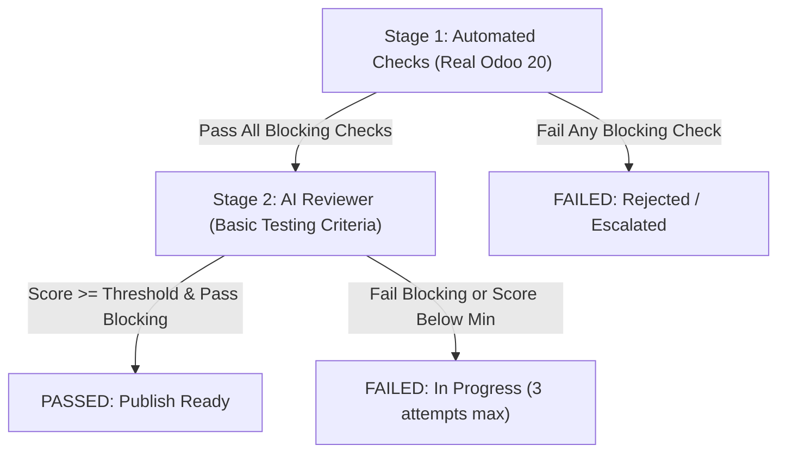
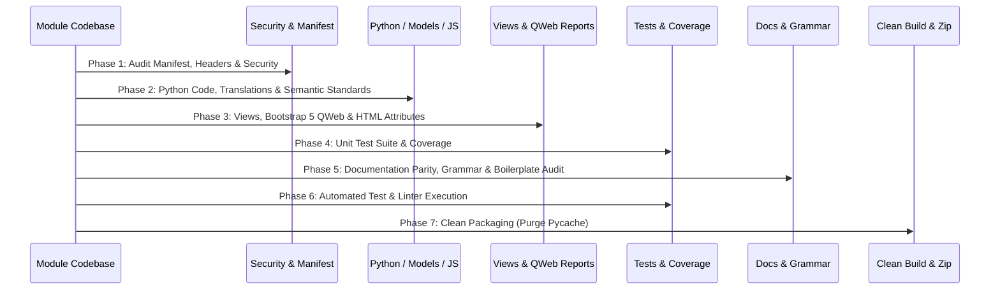

# Odoo 20 Module Migration & First-Attempt AI Pass Playbook

This playbook establishes a standard operating procedure (SOP) to audit, migrate, test, and package any Odoo module for Odoo 20 to score **100/100** and pass the Cybrosys AI Review on the first attempt.

---

## 1. Automated Checks & AI Review Scoring System

The Cybrosys review is conducted in two sequential stages:



### Stage 1: Automated Checks (Blocking)
* **Zip and Manifest Valid**: Manifest syntax, valid version (`20.0.1.0.0`), valid license (`LGPL-3`), installable is `True`.
* **Clean Dual-Installation (With & Without Demo Data)**: The module must install cleanly and pass all tests in **BOTH** environments:
  1. On a fresh database strictly **WITHOUT** demo data (`--without-demo=all`).
  2. On a fresh database **WITH** demo data.
* **Unit Tests Pass (Double Weight)**: At least one test file in `tests/`, tagged `@tagged('post_install', '-at_install')`, **0 errors, 0 failures** across both environments.
* **100% Public Method & Action Coverage**: Every public model method, compute method, constraint, button action (`action_*`), and wizard print/submit action must have a dedicated test case.
* **Code Linters**: `pylint-odoo` and `ruff` report 0 errors.

### Stage 2: AI Reviewer (Criteria 1.1 – 6.3)
* **Structure & Manifest**: Exact `depends`, all files referenced exist, no dead assets.
* **Mandatory File Header**: **EVERY** Python file must contain the exact Cybrosys LGPL-3 header.
* **Security & Access (4.2)**: Every model and transient wizard has an entry in `ir.access.csv`. Strictly enforce least privilege: infrastructure, database connector, and credential models must be restricted to `base.group_system`, not `base.group_user`. Sensitive password/secret fields must specify `groups="base.group_system"`. Audit log and synchronization models must have complete views and menus.
* **Deprecated APIs**: Zero Odoo 16/17/18/19 deprecated code.
* **Coding Standards (4.1)**: PEP8 (no ambiguous variables like E741 `l`, `O`, `I`), multi-record safe methods, SQL injection prevention on external DB queries (identifier regex validation, backtick/quote escaping, parameterized `INFORMATION_SCHEMA` queries), lowercase field type mappings matching `ir.model.fields.ttype` (`'many2one'`, not `'Many2one'`), no monkey patching, Bootstrap 5 classes in QWeb (`table-sm`), no obsolete HTML attributes (`align`), semantic field labels matching models (`res.users` labeled 'User', not 'Employee').
* **Doc-to-Code Parity & Grammar (6.3)**: `index.html`, `README.rst`, and `RELEASE_NOTES.md` match actual code. No false claims in FAQs, no template boilerplate leftovers (e.g. `#cybrosys-acc-kit`), proper English grammar (no "allows to + verb"), singular/plural consistency, and synchronized release dates.
* **No Junk (6.2 - Blocking)**: Zero `__pycache__`, `.pyc`, backup files, or unused assets in the archive or directory.

---

## 2. Mandatory Python File Header (All `.py` Files)

Every Python file across the module (including `__init__.py`, `__manifest__.py`, `models/*.py`, `wizard/*.py`, `controllers/*.py`, `report/*.py`, and `tests/*.py`) **MUST** start with this exact header:

```python
# -*- coding: utf-8 -*-
#############################################################################
#
#    Cybrosys Technologies Pvt. Ltd.
#
#    Copyright (C) 2026-TODAY Cybrosys Technologies(<https://www.cybrosys.com>)
#    Author: Cybrosys Techno Solutions(<https://www.cybrosys.com>)
#
#    You can modify it under the terms of the GNU LESSER
#    GENERAL PUBLIC LICENSE (LGPL v3), Version 3.
#
#    This program is distributed in the hope it will be useful,
#    but WITHOUT ANY WARRANTY; without even the implied warranty of
#    MERCHANTABILITY or FITNESS FOR A PARTICULAR PURPOSE.  See the
#    GNU LESSER GENERAL PUBLIC LICENSE (LGPL v3) for more details.
#
#    You should have received a copy of the GNU LESSER GENERAL PUBLIC LICENSE
#    (LGPL v3) along with this program.
#    If not, see <http://www.gnu.org/licenses/>.
#
#############################################################################
```

### Automated Header Audit & Insertion Script
Run this script to instantly check and report/fix missing headers in any module:

```bash
python3 -c "
import os

HEADER = '''# -*- coding: utf-8 -*-
#############################################################################
#
#    Cybrosys Technologies Pvt. Ltd.
#
#    Copyright (C) 2026-TODAY Cybrosys Technologies(<https://www.cybrosys.com>)
#    Author: Cybrosys Techno Solutions(<https://www.cybrosys.com>)
#
#    You can modify it under the terms of the GNU LESSER
#    GENERAL PUBLIC LICENSE (LGPL v3), Version 3.
#
#    This program is distributed in the hope it will be useful,
#    but WITHOUT ANY WARRANTY; without even the implied warranty of
#    MERCHANTABILITY or FITNESS FOR A PARTICULAR PURPOSE.  See the
#    GNU LESSER GENERAL PUBLIC LICENSE (LGPL v3) for more details.
#
#    You should have received a copy of the GNU LESSER GENERAL PUBLIC LICENSE
#    (LGPL v3) along with this program.
#    If not, see <http://www.gnu.org/licenses/>.
#
#############################################################################
'''

module_path = '.'
for root, _, files in os.walk(module_path):
    if '__pycache__' in root:
        continue
    for f in files:
        if f.endswith('.py'):
            p = os.path.join(root, f)
            with open(p, 'r', encoding='utf-8') as fh:
                content = fh.read()
            if 'Cybrosys Technologies Pvt. Ltd.' not in content:
                print(f'[MISSING HEADER] Fixing: {p}')
                with open(p, 'w', encoding='utf-8') as fh:
                    fh.write(HEADER + content.lstrip())
            else:
                print(f'[OK] {p}')
"
```

---

## 3. Phase-by-Phase Module Migration Plan



---

### Phase 1: Manifest, Dependencies & Security (Section 3.1 & 4.2)

1. **Manifest File (`__manifest__.py`)**:
   - `version`: `'20.0.1.0.0'`
   - `license`: `'LGPL-3'`
   - `author` & `company`: `'Cybrosys Techno Solutions'`
   - `maintainer`: `'Cybrosys Techno Solutions'`
   - `website`: `'https://www.cybrosys.com'`
   - `images`: `['static/description/banner.jpg']`
   - **Summary formatting**: Exactly one grammatically correct sentence ending with a period.
   - **Narrow Dependencies**:
     - Do NOT include `'base'` if other modules (like `'sale'`, `'hr_timesheet'`, etc.) are listed.
     - Only list modules whose models, fields, or XML records are directly used.
     - Declare third-party Python packages in `'external_dependencies': {'python': [...]}`.
   - **Load Order in `'data'`**:
     1. Security groups (`security/<name>_groups.xml`)
     2. Access rules (`security/ir.access.csv`)
     3. Data records / sequences (`data/...`)
     4. Views (`views/..._views.xml`)
     5. Wizards (`wizard/..._views.xml`)
     6. Reports and Templates (`report/..._reports.xml`, `report/..._templates.xml`)
     7. Menus (`views/..._menu_views.xml`)

2. **Security Access (`security/ir.access.csv`)**:
   - Every single model (`models.Model`) **and wizard** (`models.TransientModel`) MUST have an access row.
   - Follow the Odoo 20 ACL format: `id,name,model_id,group_id/id,operation,domain`.
   - **Least Privilege for Infrastructure & Credential Modules**:
     - Never grant `base.group_user` CRUD permissions on external database credentials, API secrets, or synchronization runners.
     - Infrastructure, connector, and credential models must be restricted to `base.group_system`.
     - Align ACL groups with menu security: if menus require `base.group_system`, model access must not be left open to all internal users (`base.group_user`) via RPC.
   - **Sensitive Credential Protection (`groups="base.group_system"`)**:
     - Password, private key, and API secret fields (e.g. `password = fields.Char(...)`) must declare `groups="base.group_system"`.
     - This guarantees that non-system users cannot inspect credentials through client RPC read calls.
   - Never leave models accessible to public users unless specifically required and secured.

---

### Phase 2: Python Code & Coding Standards (Section 4.1 & 4.3)

#### Coding Standards & Semantic Integrity Checklist
- **Headers**: Verify mandatory Cybrosys LGPL-3 header on every file.
- **Line Length**: Max 120 characters for code, max 79 for docstrings/comments.
- **Imports**: No double spaces in imports; group standard library first, then third-party, then Odoo.
- **Docstrings**: One clear explanatory docstring on every class and public method.
- **Semantic Field Labels vs Target Model**:
  - If a `Many2one` points to `res.users`, label it `'User'`, NOT `'Employee'`!
  - If a `Many2one` points to `hr.employee`, label it `'Employee'`.
  - Mismatching labels and models (e.g. `user_id = fields.Many2one('res.users', string='Employee')`) fails Section 4.1.
- **Grammar in Field Labels & Help Texts**:
  - Singular vs Plural: If a wizard field selects a single date, write `'Starting Date'`, NOT `'Starting Dates'`.
  - Help text: Write `'Choose the starting date.'`, NOT `'Choose the starting dates.'`.
- **Naming Conventions**:
  - Model `_name` must have the module prefix (e.g. `timesheets_by_employee.report`, not generic `report`).
  - Private methods start with `_` (e.g. `_compute_*`, `_onchange_*`, `_check_*`).
  - No single letter or ambiguous variables (E741: never use `l`, `O`, `I`; e.g. use `for key, label in selection_options:`).
  - No SQL reserved words as field names (`group`, `user`, `order`, `select`).
- **External Database Queries & SQL Injection Prevention**:
  - Never construct SQL queries via raw f-string interpolation or string concatenation of user-entered table names, column names, or filter values (`f"SELECT * FROM {self.sql_table}"`).
  - Validate all external database identifiers (table names, column names) against a strict regex whitelist (`^[A-Za-z0-9_]+$`) via `@api.constrains` and helper validation before execution.
  - Quote validated identifiers appropriately (e.g., backticks `` `table` `` for MySQL or double quotes `"` for PostgreSQL).
  - Parameterize all WHERE clauses, filters, and metadata queries (e.g., `INFORMATION_SCHEMA.KEY_COLUMN_USAGE` filtering `TABLE_SCHEMA = %s AND TABLE_NAME = %s AND COLUMN_NAME = %s`) using parameter tuples (`cursor.execute(query, params)`).
- **Field Type Mapping Casing (`ttype` match)**:
  - Odoo model field types (`ir.model.fields.ttype`) are strictly lowercase (`'many2one'`, `'one2many'`, `'many2many'`, `'integer'`, `'char'`, `'boolean'`, `'selection'`, `'float'`).
  - Relational mapping dictionaries must use exact lowercase `'many2one'` (never uppercase `'Many2one'`). Uppercase values cause valid relational/foreign type conversions to fail.
- **Multi-Record Safety**:
  - `@api.constrains`: Always loop `for record in self:`. Never assign values inside constraints.
  - Action methods expecting a single record must call `self.ensure_one()`.
  - Action return dictionaries must have python dict contexts (e.g. `'context': {'create': False}`).
- **Translatable Strings & Translations**:
  - Use `self.env._()` inside model methods (preferred in modern Odoo 18+) or `_()` from `odoo`:
    ```python
    raise UserError(self.env._("Start date must be earlier than or equal to end date."))
    ```
  - Use named placeholders: `self.env._("Order %(name)s confirmed", name=self.name)`.
  - Never use positional `%s` formatting with `_()` or `self.env._()`.
- **Exceptions**:
  - No blind `except Exception: pass`. Catch specific errors, log with `_logger.exception`, and raise translated `UserError` or `ValidationError`.
- **Cleanliness**:
  - Zero `print()`, `console.log()`, `pdb`, `breakpoint()`, or `TODO`/`FIXME` comments.

#### Odoo 20 Deprecated API Migrations

| Old / Deprecated Pattern | Odoo 20 Standard Pattern | Reason / Pitfall Avoided |
|---|---|---|
| `fields.Date.today()` | `fields.Date.context_today(self)` | `today()` ignores the user's timezone; `context_today(self)` is timezone-aware. |
| `def create(self, vals):` iterating `vals` | `def create(self, vals_list):` handle both list and dict: `vals_list = [vals_list] if isinstance(vals_list, dict) else vals_list` or call `super().create(vals_list)` | In Odoo, `create` receives a list of dicts for batch creation or a dict in test calls. Iterating a dict iterates its keys and crashes! |
| `@api.constrains(...)`<br>`def _check(self):` without loop | `for record in self:` inside every constraint | Constraints must be multi-record safe. Never assign values inside a constraint. |
| `_sql_constraints = [...]` | `models.Constraint(...)` | `_sql_constraints` is completely deprecated in Odoo 20. |
| `groups_id` on `res.users` | `group_ids` | `groups_id` was renamed to `group_ids`. Using `groups_id` causes `KeyError` or install crash. |
| `self._cr`, `self._context` | `self.env.cr`, `self.env.context` | Internal attributes are deprecated. |
| `ir.attachment.create({'datas': b64})` | `ir.attachment.create({'raw': base64.b64decode(b64)})` | `datas` has been removed from `ir.attachment` in Odoo 20 and emits a `UserWarning`. |
| Dynamic SQL joins without aliases (`JOIN rel_table ON ...`) | `JOIN rel_table AS rel_alias ON ...` | Self-referencing fields throw PostgreSQL `DuplicateAlias: table name specified more than once`. |
| Redundant string on fields (`name = fields.Char(string='Name')`) | `name = fields.Char()` | Fails `pylint-odoo` W8113. |
| Function default without lambda (`default=self.foo`) | `default=lambda self: self.foo()` | Fails `pylint-odoo` E8148 (breaks inheritability). |
| Two fields sharing the exact same string label | Differentiate string labels (e.g. `model_name` string="Model Technical Name") | Triggers registry warning `Two fields have the same label`. |
| `base.group_user` CRUD on database credentials | Restrict to `base.group_system` in `ir.access.csv` | Allows any internal user to read credentials or run sync via RPC. |
| Sensitive password/token field without `groups` | `password = fields.Char(groups='base.group_system')` | Exposes plaintext credentials over RPC to unprivileged users. |
| Audit / Sync log model without views or menu | Provide list, form, search view, action, and menu | Orphaned models without UI fail audit section 4.2. |
| Phantom required field in XML view (e.g. `ref_col_name`) | Remove phantom field from view and model | Blocks record saves and fails view validation. |
| Dead / unused model field (e.g. `sync.table.unique`) | Purge dead field from model | Violates clean schema and code standards. |
| `<group expand="0">` in search view | `<group>` (remove obsolete `expand`) | Fails Odoo 20 RelaxNG view validation. |
| Raw f-string SQL query (`f"SELECT * FROM {self.table}"`) | Regex validate identifier (`^[A-Za-z0-9_]+$`), backtick quote (`` `table` ``), and parameterize filters (`cursor.execute(query, params)`) | Raw string interpolation opens external/internal databases to SQL injection. |
| Type mapping using `'Many2one'` | Lowercase `'many2one'` | Odoo `ir.model.fields.ttype` is `'many2one'`. Capitalized `'Many2one'` causes type validation errors on valid records. |
| Ambiguous variable name `l`, `O`, `I` (`for k, l in ...`) | Descriptive names: `for key, label in ...` | Violates PEP 8 / Flake8 / Ruff rule E741 (ambiguous variable name). |
| Monkey-patching `BaseModel` | Modular extension / inheritance | Fails coding standard review 4.1. |
| `type(x) == dict` | `isinstance(x, dict)` | Violates Python / Odoo coding conventions. |

---

### Phase 3: Views, XML, QWeb & Templates (Section 4.1 & 4.2)

1. **XML Views**:
   - `<tree>` -> `<list>`: Tree views must be declared with `<list>`.
   - Invisible attributes: Use Python boolean expressions `invisible="not field_name"` or `invisible="state != 'draft'"`. Never `invisible="field_name == False"`.
   - List columns visibility: Use `column_invisible="not ..."` instead of `invisible`.
   - Button styling: Replace obsolete `btn-default` with `btn-secondary`.
   - Wizard Footers: Never nest `<footer>` inside `<sheet>` or `<group>`. Put `<footer>` directly under `<form>`.
   - **Zero Phantom / Unused Fields**:
     - Never include fields in views that are marked required or editable but never populated or used by backend logic (e.g. `ref_col_name`).
     - Purge unused, dead model fields that have no backend or frontend utility (e.g. `unique = fields.Char(...)`).
   - **Audit Logs & History Views (Completeness Rule)**:
     - Any model designed to track execution history, audit logs, or synchronized records (`imported.data`) must provide:
       1. `<list>` view (e.g. `create="false" edit="false"`).
       2. `<form>` view (e.g. `create="false" edit="false"`).
       3. `<search>` view with search fields and group-by filters.
       4. Window action (`ir.actions.act_window`) and an accessible menuitem.
   - **Search View RNG Standards**:
     - Never use obsolete `expand="0"` attribute on `<group>` in `<search>` views; it causes RelaxNG validation errors.
     - Always provide a `string` attribute on `<search string="...">`.

2. **Bootstrap 5 & Modern HTML in QWeb Reports**:
   - **Bootstrap 3 -> Bootstrap 5 Classes**:
     - `table-condensed` ➔ **`table-sm`** (Bootstrap 3 `table-condensed` is obsolete and flagged as an error!).
     - `panel`, `panel-default` ➔ `card`, `card-body`.
     - `pull-right`, `pull-left` ➔ `float-end`, `float-start`.
   - **No Obsolete HTML Presentation Attributes**:
     - `<h2 align="center">` ➔ **`<h2 class="text-center">`** (HTML `align` attribute is obsolete in HTML5 and flagged!).
     - `<td align="right">` ➔ **`<td class="text-end">`** (or `style="text-align: right;"`).
     - `<table width="100%">` ➔ **`<table class="w-100">`**.

3. **OWL JavaScript Components**:
   - Modern syntax: Use standard ES6 classes extending `Component`.
   - Never use `var self = this;` — use arrow functions `() => {}` or method binding.
   - Services: Use `useService("rpc")`, `useService("action")`, `useService("notification")` instead of deprecated direct calls or undefined `self.rpc`.
   - No direct DOM manipulation: Use OWL refs (`useRef`) and reactive state instead of `document.getElementById` or jQuery `$`.

4. **Static Assets & HTML Description (`static/description/`)**:
   - Purge draft files: Delete any temporary files (e.g., `index1.html`, unreferenced mockups/draft images).
   - Container IDs: Replace copy-pasted container IDs (e.g., `#cybrosys-acc-kit`) with module-specific IDs (e.g., `#<technical_name>`).

---

### Phase 4: Unit Test Suite & Coverage (Section 5)

> [!IMPORTANT]
> **Tests are blocking and carry double weight.** Any module submitted without tests automatically fails Stage 1.

1. **Folder & Structure**:
   ```
   tests/
   ├── __init__.py
   └── test_<main_feature>.py
   ```
2. **Tagging**:
   Always tag test classes with:
   ```python
   @tagged('post_install', '-at_install')
   class TestModuleName(TransactionCase):
   ```
3. **100% Public Method & Action Coverage**:
   - Every public model method, compute method, constraint, button action (e.g., `action_*`), and wizard execute/print method must have a dedicated test case.
   - Test both successful execution and negative validation/UserError raises.
4. **Preventing `NotNullViolation` & Field Errors**:
   - Inspect all model definitions for `required=True` before writing tests.
   - Every `create()` call in tests MUST include all required fields.
5. **Asserting Correct Titles and Content**:
   - If asserting report titles in tests, verify that the string matches the **grammatically correct singular/plural** form (e.g. `'Timesheet Report by Employee'`, not `'Timesheet Report by Employees'`).
6. **Coverage Target**:
   - Test the happy path, edge cases, error conditions, date validations, and constraints.
   - Ensure statement coverage of `models/`, `wizard/`, and `report/` is **>= 80%**.

---

### Phase 5: Documentation Parity, Grammar & Content Audit (Section 1.4, 2 & 6.3)

> [!CAUTION]
> AI Reviewer penalizes heavily for grammar errors, template boilerplate leftovers, and mismatched claims across documentation.

1. **Grammar & Phrasing Rules**:
   - **Never write "allows to [verb]"**:
     - ✗ *"This module allows to print the timesheet of selected employee"*
     - ✓ *"This module allows users to print the timesheet of the selected employee."* OR *"This module allows printing the timesheet of the selected employee."*
   - **Singular vs Plural Precision**:
     - If the module filters/prints for **one** employee:
       - Report Title: `'Timesheet Report by Employee'` (singular), NOT `'Timesheet Report by Employees'`.
       - Text: `'timesheet of the selected employee'`, NOT `'timesheet of selected employees'`.
       - Wizard labels/help: `'Starting Date'`, NOT `'Starting Dates'`.

2. **Elimination of Template Boilerplate Leftovers**:
   - Search `index.html` and `README.rst` for copy-paste artifacts from other Cybrosys apps:
     - ✗ *"chart of accounts migrations"*, *"core accounting operations"*, *"manage balance sheet"*, etc., in a timesheet or HR module!
     - ✗ Misplaced features in FAQs: e.g. claiming *"tasks performed"* if tasks are not part of the module data/report.
   - Check every single question and answer in the FAQ section of `index.html` against actual functionality.

3. **Brand & Capitalization Consistency**:
   - Proper noun casing must be consistent across the entire document:
     - Always use **`WhatsApp`** (capital 'A'), never `"Whatsapp"` and `"WhatsApp"` mixed together.
     - Always write **`Odoo 20`** (with a space), never `"Odoo20"`.

4. **Date Synchronization Across All Files**:
   - Check the date in `doc/RELEASE_NOTES.md` (e.g. `2026-10-19`).
   - Check the date/badge in `static/description/index.html` (e.g. badge saying `'Sep 2026'` vs release notes saying `2026-10-19`).
   - **The release month/year in `index.html` MUST match `doc/RELEASE_NOTES.md`!** (If release notes say October 2026, `index.html` must say October 2026).

5. **`README.rst` Formatting**:
   - Title underlined with `=====`.
   - Subsections (Installation, Usage, Credits, License, Maintainer) underlined with `-----` at the same heading level.
   - License must say `LGPL-3`.

6. **`doc/RELEASE_NOTES.md`**:
   - Format:
     ```markdown
     ## Module <technical_name>

     #### 2026-10-19
     #### Version 20.0.1.0.0
     #### ADD

     - Initial release for Odoo 20: <clear description>.
     ```

---

### Phase 6: Automated Verification & Test Commands

Before packaging, execute the following commands locally:

```bash
# 1. Clean test install & unit tests WITHOUT demo data (blocking)
/home/cybrosys/odoo20/.venv/bin/python /home/cybrosys/odoo20/odoo-bin -c odoo.conf \
    -d <db_no_demo> -i <technical_name> --without-demo=all --test-enable --test-tags <technical_name> --stop-after-init

# 2. Clean test install & unit tests WITH demo data (blocking)
/home/cybrosys/odoo20/.venv/bin/python /home/cybrosys/odoo20/odoo-bin -c odoo.conf \
    -d <db_with_demo> -i <technical_name> --test-enable --test-tags <technical_name> --stop-after-init

# 3. Check for linter issues (pylint-odoo & ruff)
pylint --load-plugins=pylint_odoo --disable=all --enable=odoolint \
       --valid-odoo-versions=20.0 migration/<technical_name>

ruff check migration/<technical_name>

# 4. Check README rendering
python -m docutils migration/<technical_name>/README.rst > /dev/null
```

---

### Phase 7: Clean Packaging & Final Self-Review (Section 6.1 & 6.2)

> [!CAUTION]
> **Zero Junk Rule (6.2 - Blocking):** Running tests compiles bytecode (`__pycache__` and `.pyc`). You MUST run the purge commands immediately after testing. Even if the user requests to compress the zip manually, the module directory must be left completely purged of `__pycache__` and `.pyc`.

1. **Purge Junk Files (Mandatory across all module files)**:
   ```bash
   cd /home/cybrosys/odoo20/migration/<technical_name>
   find . -type d -name "__pycache__" -exec rm -rf {} +
   find . -type f -name "*.pyc" -delete
   find . -type f -name ".DS_Store" -delete
   find . -type f -name "*~" -delete
   ```

2. **Build Clean Archive (If building zip)**:
   ```bash
   cd /home/cybrosys/odoo20/migration
   zip -qr <technical_name>-20.0.1.0.0.zip <technical_name> \
       -x '*__pycache__*' '*.pyc' '*/.git/*' '*/.git' '*/.gitignore' '*.DS_Store' '__MACOSX/*'

   # Verify no junk got packaged (must return nothing)
   unzip -l <technical_name>-20.0.1.0.0.zip | grep -E 'pycache|\.pyc|\.git|DS_Store|__MACOSX' || echo "Clean: No junk found"
   ```
   *(Note: If the user chooses to compress manually, verify that the directory has 0 `__pycache__` or `.pyc` files before concluding the task).*

---

## 4. Module Migration Checklist (Copy for Every Task)

- [ ] **Technical Name & Structure**:
  - [ ] Name is lowercase `snake_case`.
  - [ ] All standard folders: `models/`, `views/`, `security/`, `static/description/`, `tests/`, `doc/`.
- [ ] **Mandatory Header & Standards (Section 2 & 4.1)**:
  - [ ] Every Python file has the exact Cybrosys LGPL-3 header with UTF-8 encoding.
  - [ ] Line length $\le 120$ characters.
  - [ ] No double spaces in imports.
  - [ ] Docstrings on all classes and public methods.
  - [ ] Translatable strings use `self.env._("... %(x)s", x=val)`.
  - [ ] Semantic label parity: `res.users` labeled 'User', `hr.employee` labeled 'Employee'.
  - [ ] Singular/plural precision in labels and help texts (e.g. 'Starting Date', not 'Starting Dates').
  - [ ] No `print()`, `console.log()`, `pdb`, or `TODO`/`FIXME`.
- [ ] **Manifest & Security (Section 3.1 & 4.2)**:
  - [ ] Version `20.0.1.0.0`, license `LGPL-3`, author/maintainer `Cybrosys Techno Solutions`.
  - [ ] Summary is a single complete sentence ending with a period.
  - [ ] `depends` contains only strictly necessary modules (no superfluous `base`).
  - [ ] Every model and wizard has an entry in `security/ir.access.csv`.
- [ ] **Code Modernization (Odoo 20)**:
  - [ ] `fields.Date.context_today(self)` instead of `fields.Date.today()`.
  - [ ] `create(self, vals_list)` handles dict or list safely without crashing.
  - [ ] `@api.constrains` iterates over `self`.
  - [ ] No `_sql_constraints`; uses `models.Constraint`.
  - [ ] No `self._cr` or `self._context`; uses `self.env.cr`, `self.env.context`.
  - [ ] Attachments use `raw=...` instead of deprecated `datas=...`.
  - [ ] Dynamic SQL joins use unique table aliases.
  - [ ] No duplicate field label strings on the same model.
  - [ ] Lambda default on functions: `default=lambda self: self.get_default(...)`.
- [ ] **Views & QWeb Reports (Section 4.1 & 4.2)**:
  - [ ] `<tree>` converted to `<list>`.
  - [ ] `invisible` uses modern syntax (`invisible="not field"`).
  - [ ] Button styling uses `btn-secondary` instead of `btn-default`.
  - [ ] Wizard `<footer>` is direct child of `<form>`, outside `<sheet>`/`<group>`.
  - [ ] QWeb reports: `table-condensed` converted to `table-sm`.
  - [ ] QWeb reports: No obsolete `align="center"` / `align="right"`; uses `class="text-center"` / `class="text-end"`.
  - [ ] JS uses OWL services (`useService`), no `var self = this`, no direct DOM access.
- [ ] **Tests & Linters (Section 5)**:
  - [ ] Clean install & unit tests pass on fresh database **WITHOUT demo data** (`--without-demo=all`) with **0 failed, 0 errors**.
  - [ ] Clean install & unit tests pass on fresh database **WITH demo data** with **0 failed, 0 errors**.
  - [ ] Unit tests cover 100% of public model functions and actions.
  - [ ] Test record creation populates all `required=True` fields.
  - [ ] Title assertions in tests match the correct singular/plural report title.
  - [ ] `models/` code coverage is >= 80%.
  - [ ] `pylint-odoo` and `ruff` return 0 errors.
- [ ] **Documentation Parity & Grammar (Section 6.3)**:
  - [ ] No "allows to + verb" (use "allows users to + verb" or "allows + verb-ing").
  - [ ] Singular vs Plural: Report title and descriptions match single vs multiple records.
  - [ ] No boilerplate leftovers (e.g. accounting text in timesheets/HR modules).
  - [ ] FAQs accurately reflect actual module features only.
  - [ ] Brand casing consistent (e.g. "WhatsApp", not "Whatsapp").
  - [ ] Date synchronization: `index.html` month/year matches `RELEASE_NOTES.md`.
  - [ ] `README.rst` headings and license are properly formatted.
  - [ ] `doc/RELEASE_NOTES.md` has ISO date and "Odoo 20" title.
- [ ] **Packaging (Section 6.2)**:
  - [ ] Zero `__pycache__`, `.pyc`, `.gitkeep`, or unused asset files.
  - [ ] Zip named `<technical_name>-20.0.1.0.0.zip` with module folder at root.
