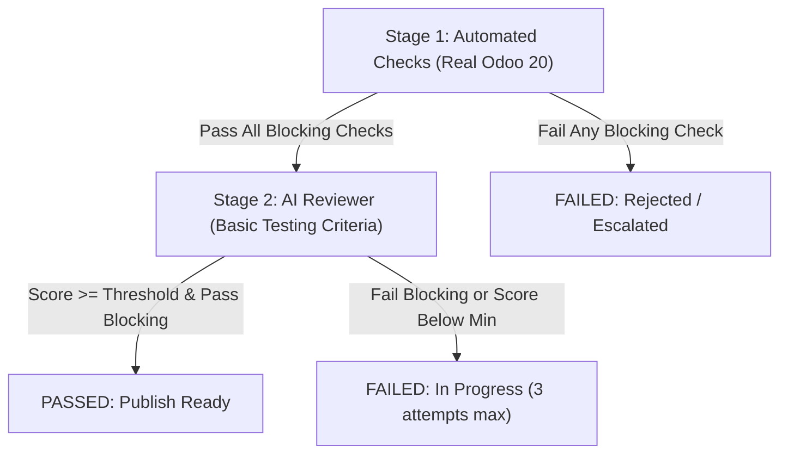
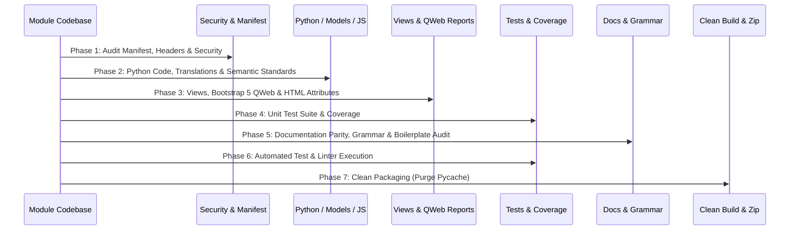

# Odoo 20 Module Migration & First-Attempt AI Pass Playbook

This playbook establishes a standard operating procedure (SOP) to audit, migrate, test, and package any Odoo module for Odoo 20 to score **100/100** and pass the Cybrosys AI Review on the first attempt.

---

## 1. Automated Checks & AI Review Scoring System

The Cybrosys review is conducted in two sequential stages:



### Stage 1: Automated Checks (Blocking)
* **Zip and Manifest Valid**: Manifest syntax, valid version (`20.0.1.0.0`), valid license (`LGPL-3`), installable is `True`.
* **External Python Dependencies Valid (Criterion 5.1–5.2 Blocking)**: Every entry in `'external_dependencies': {'python': [...]}` MUST be an installable **PyPI distribution name** (e.g., `'pillow'`, `'mysql-connector-python'`, `'beautifulsoup4'`), NEVER a Python import module name (e.g., `'PIL'`, `'mysql.connector'`, `'bs4'`). Odoo 20 checks PyPI metadata via `importlib.metadata.version(...)` (`odoo/modules/module.py`), and automated review sandboxes run `pip install` against this list; a single invalid PyPI name (like `'PIL'`) aborts the entire `pip install` and blocks installation (`0/100`).
* **Clean Dual-Installation (With & Without Demo Data)**: The module must install cleanly and pass all tests in **BOTH** environments:
  1. On a fresh database strictly **WITHOUT** demo data (`--without-demo=all`).
  2. On a fresh database **WITH** demo data.
* **Unit Tests Pass (Double Weight)**: At least one test file in `tests/`, tagged `@tagged('post_install', '-at_install')`, **0 errors, 0 failures** across both environments.
* **Hermetic Unit Tests (Blocking)**: Tests must execute cleanly inside a minimal review container containing **only** the Python dependencies declared in `'external_dependencies': {'python': [...]}` — never relying on host-installed OS binaries (`tesseract`, `pdftoppm`, `pdfinfo`, LibreOffice, Chromium), external network endpoints, or external DB servers. All external CLI/service calls must be mocked with `unittest.mock.patch` for both happy paths and failure paths.
* **100% Public Method & Action Coverage**: Every public model method, compute method, constraint, button action (`action_*`), and wizard print/submit action must have a dedicated test case.
* **Code Linters & Static Analysis (Blocking)**: `pylint-odoo` reports **0 errors and 0 warnings** (strictly 0 `W8113` redundant string warnings, strictly 0 `W8161` translation method warnings), and `ruff` / `flake8` reports **0 errors** (strictly 0 `F401` unused imports and 0 `F841` unused local variables).

### Stage 2: AI Reviewer (Criteria 1.1 – 6.3)
* **Criterion 1.2: Structure and Required Files (Blocking)**:
  - Every module MUST contain `static/description/index.html` tracked and committed in the Git repository tree.
  - The module description `static/description/index.html`, module icon `static/description/icon.png`, and release notes `doc/RELEASE_NOTES.md` are standard required files.
  - **Git Tree Rename Pitfall**: Never use `git mv static/description/index.html static/description/index1.html`. Renaming stages `index.html` as deleted in Git. If a new `index.html` is generated on disk but not staged with `git add`, the committed tree contains `index1.html` while `index.html` is missing, triggering a blocking failure under Criterion 1.2 (*"Missing required static/description/index.html is NOT in the tree (index1.html is present, but manifest references index.html)"*). Always copy (`cp`), stage the new `index.html`, and verify with `git ls-files static/description/`.
* **Criterion 1.5: No Missing, Unused or Duplicate Files (Blocking - Score Penalty down to 40/100 or 60/100)**:
  - **Mandatory Deprecation of `security/ir.model.access.csv` in Odoo 20**:
    In Odoo 20, the legacy access control file `security/ir.model.access.csv` is completely deprecated and replaced by `security/ir.access.csv`.
    - If `security/ir.model.access.csv` is present in the repository or still referenced in `__manifest__.py`, the reviewer awards a failing **40/100** score on Criterion 1.5 (*"security/ir.model.access.csv is used instead of security/ir.access.csv, which is deprecated in Odoo 20"*).
    - **Resolution**: Permanently delete `security/ir.model.access.csv` (`rm security/ir.model.access.csv`) and migrate all access rules into `security/ir.access.csv`. Update `'data'` in `__manifest__.py` to load `'security/ir.access.csv'`.
  - **Mandatory Deletion of Legacy/Draft Description Files (`index1.html`) (Score Penalty down to 60/100)**:
    - Temporary backup or reference files created during `index.html` description updates, specifically `static/description/index1.html`, MUST be permanently deleted before submitting for review.
    - If `static/description/index1.html` exists in the module tree, the reviewer awards a failing **60/100** score on Criterion 1.5 (*"The file 'static/description/index1.html' exists in the tree but is not referenced in the manifest or used by the system"*).
    - **Resolution**: Once data extraction and visual comparison are verified against the new `index.html`, immediately delete `static/description/index1.html` (`rm -f static/description/index1.html` and `git rm -f static/description/index1.html` if tracked).
  - No orphaned XML, JS, or image files that are not referenced in the manifest or code.
* **Mandatory File Header**: **EVERY** Python file must contain the exact Cybrosys LGPL-3 header.
* **Criterion 4.1: Coding Standards & Modernization (Blocking - Score Penalty down to 40/100)**:
  - **Required Unified Access Control File (`security/ir.access.csv`)**:
    - In Odoo 20, using `security/ir.model.access.csv` instead of `security/ir.access.csv` is considered an outdated coding pattern and triggers a blocking **40/100** score under Criterion 4.1 (*"ir.model.access.csv is used instead of ir.access.csv which is required in Odoo 20"*).
    - Note the **Dual-Criterion Blocking Penalty**: retaining `ir.model.access.csv` penalizes **both** Criterion 1.5 (obsolete file) and Criterion 4.1 (outdated coding standard).
    - The module must strictly use the unified 6-column format in `security/ir.access.csv`: `id,name,model_id:id,group_id:id,operation,domain`.
  - **Strict Prohibition of XML `<record model="ir.access">` for Record Rules**:
    - In Odoo 20, both access rights and row-level record rules (restrictions with domains) are unified in `ir.access` and **MUST** be defined in `security/ir.access.csv`.
    - **NEVER** define `<record model="ir.access">` inside XML files for record rules or access control. Doing so triggers a severe AI Review failure (40/100 on Criterion 4.1: *"The module uses the model 'ir.access' for record rules... This is a critical code error"* and 30/100 on Criterion 4.2).
    - In Odoo 20, XML files under `security/` are strictly reserved for declaring security groups (`res.groups`, `res.groups.privilege`). All record rules and permissions belong in `security/ir.access.csv`.
  - **Valid Domain Syntax in `security/ir.access.csv` / Security Domains (Strict AI Review Standard)**:
    - Security domains in `security/ir.access.csv` **MUST** be written as valid Odoo domain lists using standard prefix notation with pure field-operator-value tuples (e.g. `['|', cond1, cond2]`).
    - **Strict Prohibition of Ternary Operators**: NEVER use Python ternary operators anywhere in domain strings (neither returning lists like `[...] if cond else [...]` nor inside tuples like `(1, '=', 1 if cond else 0)`). Any ternary operator in a domain string triggers immediate AI Review failures: Criterion 4.1 (20/100 - *"not a valid Odoo domain expression. It contains ternary operators"*) and Criterion 5.3 (30/100 - *"Main functionality is broken due to the invalid domain syntax"*).
    - **No Method Calls in Domains**: Never call methods like `user.has_group(...)` in domain strings; this triggers `Unsafe function access` security warnings.
    - **No Computed Field References**: Never reference `@api.depends` computed fields (like `user.is_admin`) in security domains. The AI reviewer rejects computed field evaluation in domain contexts.
    - **Standard Odoo Domain Pattern**: Use ONLY simple field conditions matching core Odoo conventions: `[('field', 'operator', user.attribute)]` or `[('field', 'operator', literal)]`. Core examples: `[('user_id', '=', user.id)]`, `['|', ('restrict_user_ids', '=', False), ('restrict_user_ids', 'in', [user.id])]`.
    - **Admin Bypass via Permission Row**: To grant full access to administrators/managers, add a separate row in `ir.access.csv` with `group_id:id = base.group_erp_manager` and an empty domain (`kind='permission'`). Because permissions are OR-ed in Odoo 20, managers bypass restrictions without needing conditional bypasses in the restriction domain itself.
    - **Conditional Logic Belongs in Models**: When restrictions involve conditional logic (e.g. product vs category vs open access), compute and store the permitted records into a relational field (e.g. `restrict_user_ids` on the target model) rather than attempting to encode complex conditional Python logic inside the domain string.
  - **PEP8 & Multi-Record Safety**: PEP8 (no ambiguous variables like E741 `l`, `O`, `I`), multi-record safe methods, loop inside `@api.constrains`.
  - **SQL Injection Prevention**: Regex identifier validation (`^[A-Za-z0-9_]+$`), backtick/quote escaping, parameterized queries.
  - **Field Type Mapping Casing**: Exact lowercase `'many2one'` (never uppercase `'Many2one'`).
  - **Semantic Field Labels & Redundant Strings (W8113)**: Omit `string=` when matching default computed title.
  - **Views & QWeb**: Bootstrap 5 classes (`table-sm`), no obsolete HTML attributes (`align`), `<tree>` converted to `<list>`.
* **Criterion 4.2: Models, Views, Security and Data (Blocking - Score Penalty down to 40/100)**:
  - **Mandatory XML ID Format for `model_id:id` (Blocking Rule)**:
    - In `security/ir.access.csv`, the model reference column header **MUST** be `model_id:id` (with `:id` suffix) and its value **MUST** strictly reference the model's XML ID: `model_<technical_name_underscored>` (e.g. `model_undo_redo`).
    - **NEVER** use raw technical dot-notation model names (e.g. `undo.redo`) in `ir.access.csv`. Referencing raw dot-notation triggers an automatic blocking **40/100** score under Criterion 4.2 (*"security/ir.access.csv references model_id as '<model_name>' instead of the proper XML ID format"*).
  - **Security Groups Header**: Group references column header **MUST** be `group_id:id` (e.g. `undo_redo.group_undo_redo_user`, `base.group_user`).
  - **Row-Level Record Rules (Restrictions) in `security/ir.access.csv`**:
    - To define a row-level record rule (global restriction) in Odoo 20, add an entry to `security/ir.access.csv` with:
      - `id`: Unique XML ID (e.g. `<module>_rule_<name>`)
      - `name`: Descriptive rule name
      - `model_id:id`: Target model XML ID (e.g. `product.model_product_template`)
      - `group_id:id`: **Leave blank** for global restrictions, or specify a group for group-specific permissions
      - `operation`: Operations covered (`crud`, `r`, `cu`, etc.)
      - `domain`: Valid Odoo prefix-notation domain string
  - **Complete Model Coverage**: Every single model (`models.Model`) and transient model / wizard (`models.TransientModel`) MUST have an access row in `security/ir.access.csv`.
  - **Strict Least Privilege**: Infrastructure, database connector, and credential models must be restricted to `base.group_system`, not `base.group_user`. Sensitive password/secret fields must specify `groups="base.group_system"`. Audit log and synchronization models must have complete views and menus.
* **Criterion 4.3: No Debug or Deprecated Code (Blocking - Score Penalty down to 40/100)**:
  - **Zero Debug Artifacts**:
    - Absolute prohibition against `print()` statements in Python and `console.log()` / `debugger;` in JavaScript.
    - Zero `breakpoint()`, `import pdb`, `pdb.set_trace()`, or `import ipdb`.
    - Zero commented-out code lines (e.g. `# print(...)`, `# record.write(...)`, `# field = fields.Char(...)`).
    - An AI Reviewer LLM triggers a blocking **40/100** score on Criterion 4.3 (*"Contains debug code (print statements and commented-out lines) in <file>"*) if any debug stubs, commented code, or uncleaned hooks are detected.
  - **Hook Cleanliness & Docstring Requirement**:
    - Files like `hooks.py` must define clean docstrings immediately following `def post_init_hook(env):` and `def uninstall_hook(env):`.
    - Never leave blank empty lines between `def hook(...)` and its first statement.
    - Never use blind exception suppression (`except Exception: pass`) in hooks or models; always catch specific exceptions and log with `_logger.warning(...)` or `_logger.exception(...)`.
  - **Whitespace & Formatting Hygiene**:
    - Zero trailing whitespace and zero raw tabs (`\t`) in `.py`, `.js`, `.xml`, or `.csv` files.
    - Clean standard 4-space indentation across all Python logic.
* **Criterion 4.4: Code Checkers (pylint-odoo & ruff / flake8 - Blocking - Score Penalty down to 40/100)**:
  - **Zero Linter Errors or Warnings**:
    - `pylint-odoo` must report **0 errors and 0 warnings** (specifically 0 `W8113` redundant string warnings and 0 `W8161` translation method warnings).
    - `ruff` / `flake8` must report **0 errors** across all module files including `models/`, `wizard/`, `report/`, `controllers/`, and `tests/`.
  - **Zero Translation Warnings (W8161 - Blocking)**:
    - In Odoo 18/20, `pylint-odoo` enforces `W8161` (*"Better using self.env._"*).
    - Inside any method of `models.Model` or `models.TransientModel` (or wherever `self.env` is available), **ALWAYS** use `self.env._("...")` instead of standalone `_("...")`.
    - Calling `_("...")` directly inside model/wizard methods triggers `W8161`.
    - When updating to `self.env._()`, remove `from odoo import _` from imports if `_` is not used elsewhere in the file to prevent `F401` (*"unused import"*).
  - **Zero Unused Imports (F401 - Blocking)**:
    - Absolute prohibition against unused imports across models, wizards, controllers, and tests.
    - Specifically beware when refactoring translations: when replacing `_("...")` with `self.env._("...")`, ensure `from odoo import _` is removed from imports if `_` is no longer used directly.
  - **Zero Unused Local Variables (F841 - Blocking)**:
    - Never assign expressions or method returns to local variables that are never read or asserted (e.g. `invoice = self.order._create_invoices()` where `invoice` is never referenced again).
    - In unit tests and model logic, either assert the created record (e.g. `self.assertTrue(invoice)`) or call the method without assigning an unused return value (`self.order._create_invoices()`).
* **Deprecated APIs**: Zero Odoo 16/17/18/19 deprecated code (including legacy `security/ir.model.access.csv`).
* **Doc-to-Code Parity & Grammar (6.3)**: `index.html`, `README.rst`, and `RELEASE_NOTES.md` match actual code. No false claims in FAQs, no template boilerplate leftovers (e.g. `#cybrosys-acc-kit`), proper English grammar (no "allows to + verb"), singular/plural consistency, and synchronized release dates.
* **Criterion 6.2: No Junk in the Submission (Blocking - Score Penalty down to 70/100)**:
  - Zero `__pycache__`, `.pyc`, backup files (`*~`, `*.bak`), temporary draft files (`index1.html`), or unused assets in the module directory or archive.
  - If `static/description/index1.html` or draft files remain in the module tree, the reviewer awards a failing **70/100** score on Criterion 6.2 (*"The file 'static/description/index1.html' is present in the submission but serves no purpose, indicating junk/unwanted files"*).
  - Note the **Dual-Criterion Blocking Penalty**: leaving `index1.html` penalizes **both** Criterion 1.5 (unused unreferenced file - 60/100) and Criterion 6.2 (junk in submission - 70/100). Both criteria must pass with 100/100.

---

## 2. Mandatory Python File Header (All `.py` Files)

Every Python file across the module (including `__init__.py`, `__manifest__.py`, `models/*.py`, `wizard/*.py`, `controllers/*.py`, `report/*.py`, and `tests/*.py`) **MUST** start with this exact header:

```python
# -*- coding: utf-8 -*-
#############################################################################
#
#    Cybrosys Technologies Pvt. Ltd.
#
#    Copyright (C) 2026-TODAY Cybrosys Technologies(<https://www.cybrosys.com>)
#    Author: Cybrosys Techno Solutions(<https://www.cybrosys.com>)
#
#    You can modify it under the terms of the GNU LESSER
#    GENERAL PUBLIC LICENSE (LGPL v3), Version 3.
#
#    This program is distributed in the hope it will be useful,
#    but WITHOUT ANY WARRANTY; without even the implied warranty of
#    MERCHANTABILITY or FITNESS FOR A PARTICULAR PURPOSE.  See the
#    GNU LESSER GENERAL PUBLIC LICENSE (LGPL v3) for more details.
#
#    You should have received a copy of the GNU LESSER GENERAL PUBLIC LICENSE
#    (LGPL v3) along with this program.
#    If not, see <http://www.gnu.org/licenses/>.
#
#############################################################################
```

### Automated Header Audit & Insertion Script
Run this script to instantly check and report/fix missing headers in any module:

```bash
python3 -c "
import os

HEADER = '''# -*- coding: utf-8 -*-
#############################################################################
#
#    Cybrosys Technologies Pvt. Ltd.
#
#    Copyright (C) 2026-TODAY Cybrosys Technologies(<https://www.cybrosys.com>)
#    Author: Cybrosys Techno Solutions(<https://www.cybrosys.com>)
#
#    You can modify it under the terms of the GNU LESSER
#    GENERAL PUBLIC LICENSE (LGPL v3), Version 3.
#
#    This program is distributed in the hope it will be useful,
#    but WITHOUT ANY WARRANTY; without even the implied warranty of
#    MERCHANTABILITY or FITNESS FOR A PARTICULAR PURPOSE.  See the
#    GNU LESSER GENERAL PUBLIC LICENSE (LGPL v3) for more details.
#
#    You should have received a copy of the GNU LESSER GENERAL PUBLIC LICENSE
#    (LGPL v3) along with this program.
#    If not, see <http://www.gnu.org/licenses/>.
#
#############################################################################
'''

module_path = '.'
for root, _, files in os.walk(module_path):
    if '__pycache__' in root:
        continue
    for f in files:
        if f.endswith('.py'):
            p = os.path.join(root, f)
            with open(p, 'r', encoding='utf-8') as fh:
                content = fh.read()
            if 'Cybrosys Technologies Pvt. Ltd.' not in content:
                print(f'[MISSING HEADER] Fixing: {p}')
                with open(p, 'w', encoding='utf-8') as fh:
                    fh.write(HEADER + content.lstrip())
            else:
                print(f'[OK] {p}')
"
```

---

## 3. Phase-by-Phase Module Migration Plan



---

### Phase 1: Manifest, Dependencies & Security (Section 3.1 & 4.2)

1. **Manifest File (`__manifest__.py`)**:
   - `version`: `'20.0.1.0.0'` (must match `20.0.x.y.z` format; avoids `pylint-odoo` C8106 `manifest-version-format`).
   - `license`: `'LGPL-3'`
   - `author` & `company`: `'Cybrosys Techno Solutions'` (avoids `pylint-odoo` C8101 `manifest-required-author`).
   - `maintainer`: `'Cybrosys Techno Solutions'`
   - `website`: `'https://www.cybrosys.com'`
   - `images`: `['static/description/banner.jpg']`
   - **Summary formatting**: Exactly one grammatically correct sentence ending with a period.
   - **Category Precision**: Choose standard, semantically accurate categories matching Odoo App Store taxonomies. For example, modules modifying product availability, catalog restrictions, quotations, or customer sales workflows must declare `'category': 'Sales'` (or `'Sales/Sales'`). Never misclassify sales or user catalog restrictions under generic `'Inventory'` or `'Extra Tools'`.
   - **Manifest Hygiene & Pylint Compliance (`pylint-odoo` odoolint)**:
     - **No Deprecated Keys (C8103 `manifest-deprecated-key`)**: Do NOT declare `'description'` in `__manifest__.py`. Module documentation resides exclusively in `README.rst` and `static/description/index.html`.
     - **No Superfluous Default Keys (C8116 `manifest-superfluous-key`)**: Omit manifest keys that match Odoo's default values:
       - Omit `'installable': True` (default is `True`).
       - Omit `'auto_install': False` (default is `False`).
       - Omit `'application': False` (default is `False`; only specify `'application': True` if the module is a standalone application).
   - **Narrow Dependencies**:
     - Do NOT include `'base'` if other modules (like `'sale'`, `'hr_timesheet'`, etc.) are listed.
     - Only list modules whose models, fields, or XML records are directly used.
     - **PyPI Package Names Only in `'external_dependencies': {'python': [...]}` (Criterion 5.1–5.2 Blocking)**:
       - Declare third-party Python packages using their exact installable **PyPI distribution names**, NEVER their Python import names. In Odoo 20 (`odoo/modules/module.py`, `check_python_external_dependency`), Odoo resolves `importlib.metadata.version(...)`, and clean review sandboxes run `pip install` directly from PyPI against this list.
       - **Do not rely on local tests alone to catch mismatches**: if a package is pre-installed locally under its true distribution name (e.g., `Pillow`), Odoo 20's fallback (`importlib.import_module('PIL')`) silently succeeds with only a logger warning locally—masking a blocking failure in a clean review sandbox where batch `pip install` aborts on `'PIL'` before installing *any* dependency in the list (`PackageNotFoundError` ➔ `0/100`).
       - **Common Import Name ✗ ➔ PyPI Distribution Name ✓**:
         - `'PIL'` ✗ ➔ `'pillow'` ✓ (keep `from PIL import ...` in Python code)
         - `'bs4'` ✗ ➔ `'beautifulsoup4'` ✓
         - `'cv2'` ✗ ➔ `'opencv-python'` (or `'opencv-python-headless'`) ✓
         - `'Crypto'` / `'Cryptodome'` ✗ ➔ `'pycryptodome'` ✓
         - `'yaml'` ✗ ➔ `'PyYAML'` ✓
         - `'dateutil'` ✗ ➔ `'python-dateutil'` ✓
         - `'sklearn'` ✗ ➔ `'scikit-learn'` ✓
         - `'docx'` ✗ ➔ `'python-docx'` ✓
         - `'fitz'` ✗ ➔ `'PyMuPDF'` ✓
         - `'OpenSSL'` ✗ ➔ `'pyOpenSSL'` ✓
         - `'magic'` ✗ ➔ `'python-magic'` ✓
         - `'mysql'` / `'mysql.connector'` ✗ ➔ `'mysql-connector-python'` ✓
   - **Load Order in `'data'`**:
     1. Security groups (`security/<name>_groups.xml`)
     2. Access rules (`security/ir.access.csv` — **NEVER** `security/ir.model.access.csv`!)
     3. Data records / sequences (`data/...`)
     4. Views (`views/..._views.xml`)
     5. Wizards (`wizard/..._views.xml`)
     6. Reports and Templates (`report/..._reports.xml`, `report/..._templates.xml`)
     7. Menus (`views/..._menu_views.xml`)

2. **Security Access Migration: `ir.model.access.csv` ➔ `ir.access.csv` (Criterion 1.5 & 4.2)**:
   > [!IMPORTANT]
   > **Odoo 20 Security Architecture Change**:
   > In Odoo 20, `ir.model.access` and `ir.rule` have been unified into `ir.access`. The legacy access control file `security/ir.model.access.csv` is **completely deprecated** and triggers an immediate AI Review failure (40/100 on Criterion 1.5).
   > You must migrate all ACL entries into `security/ir.access.csv` and permanently delete `security/ir.model.access.csv`.

   - **Schema Differences**:
     - **Legacy Odoo 16/17/18/19 (`ir.model.access.csv`) — 8 columns**:
       ```csv
       id,name,model_id:id,group_id:id,perm_read,perm_write,perm_create,perm_unlink
       access_undo_redo,undo.redo,model_undo_redo,base.group_user,1,1,1,1
       ```
     - **Odoo 20 Standard (`ir.access.csv`) — 6 columns**:
       ```csv
       id,name,model_id:id,group_id:id,operation,domain
       access_undo_redo,access.undo.redo,model_undo_redo,base.group_user,crud,
       ```

   - **Column Conversion Mapping Table**:
     | Legacy Header (`ir.model.access.csv`) | Odoo 20 Header (`ir.access.csv`) | Notes / Transformation |
     |---|---|---|
     | `id` | `id` | Unique XML ID (e.g. `access_my_model`) |
     | `name` | `name` | Descriptive name (e.g. `access.my.model`) |
     | `model_id:id` | `model_id:id` | **Strict XML ID format** (`model_<technical_name_underscored>`, e.g. `model_undo_redo`). **CRITICAL (Criterion 4.2)**: Do NOT strip `model_` or use raw dot notation (`undo.redo`). Raw dot notation triggers a blocking 40/100 failure under Criterion 4.2! |
     | `group_id:id` | `group_id:id` | External group XML ID (e.g. `base.group_user`, `<module>.<group_name>`, or leave blank for global) |
     | `perm_read,perm_write,perm_create,perm_unlink` | `operation` | Combination of active permission characters: `c` (create), `r` (read), `u` (update/write), `d` (delete/unlink). Full CRUD `1,1,1,1` = `crud`; Read-only `1,0,0,0` = `r`; Read/Write `1,1,0,0` = `ru`. |
     | *(new column)* | `domain` | Optional domain rule string (e.g. `[('company_id', 'in', company_ids)]`) or leave empty for unrestricted model access. |

   - **Automated CSV Migration Script**:
     To convert any existing legacy `security/ir.model.access.csv` to `security/ir.access.csv`:
     ```bash
     python3 -c "
     import csv, os

     old_p = 'migration/<technical_name>/security/ir.model.access.csv'
     new_p = 'migration/<technical_name>/security/ir.access.csv'
     if os.path.exists(old_p):
         with open(old_p, 'r', encoding='utf-8') as f_in, open(new_p, 'w', encoding='utf-8', newline='') as f_out:
             reader = csv.DictReader(f_in)
             writer = csv.writer(f_out)
             writer.writerow(['id', 'name', 'model_id:id', 'group_id:id', 'operation', 'domain'])
             for row in reader:
                 mid = row.get('model_id:id') or row.get('model_id', '')
                 # Ensure proper XML ID format 'model_<name_with_underscores>'
                 if not mid.startswith('model_'):
                     mid = f'model_{mid.replace(\".\", \"_\")}'
                 gid = row.get('group_id:id') or row.get('group_id/id', '')
                 ops = ''
                 if row.get('perm_create') in ('1', 1): ops += 'c'
                 if row.get('perm_read') in ('1', 1): ops += 'r'
                 if row.get('perm_write') in ('1', 1): ops += 'u'
                 if row.get('perm_unlink') in ('1', 1): ops += 'd'
                 writer.writerow([row.get('id', ''), row.get('name', ''), mid, gid, ops, ''])
         os.remove(old_p)
         print(f'[MIGRATED] Converted {old_p} -> {new_p} with model_id:id XML ID format and removed legacy file.')
     else:
         print('[OK] No legacy ir.model.access.csv found.')
     "
     ```

   - **Strict Enforcement & Least Privilege (4.2)**:
     - Every single model (`models.Model`) **and wizard** (`models.TransientModel`) MUST have an access row in `security/ir.access.csv`.
     - Manifest `'data'` list MUST load `'security/ir.access.csv'`, NEVER `'security/ir.model.access.csv'`.
     - **Least Privilege for Infrastructure & Credential Modules**:
       - Never grant `base.group_user` CRUD permissions on external database credentials, API secrets, or synchronization runners.
       - Infrastructure, connector, and credential models must be restricted to `base.group_system`.
       - Align ACL groups with menu security: if menus require `base.group_system`, model access must not be left open to all internal users (`base.group_user`) via RPC.
     - **Sensitive Credential Protection (`groups="base.group_system"`)**:
       - Password, private key, and API secret fields (e.g. `password = fields.Char(...)`) must declare `groups="base.group_system"`.
       - This guarantees that non-system users cannot inspect credentials through client RPC read calls.
     - Never leave models accessible to public users unless specifically required and secured.
     - `security/ir.model.access.csv` MUST be permanently deleted from disk and git.

   - **Row-Level Record Rules (Restrictions) in `security/ir.access.csv` (No XML `<record model="ir.access">`)**:
     - In Odoo 20, row-level record rules (formerly `ir.rule`) are defined directly in `security/ir.access.csv` as global restrictions or group-specific rules.
     - **Global Restriction (AND-ed across all users)**:
       Leave `group_id:id` **empty/blank**. When `group_id` is empty, Odoo 20 computes `kind = 'restriction'`, meaning the rule acts as a global filter that is AND-ed with all model permissions.
       ```csv
       id,name,model_id:id,group_id:id,operation,domain
       product_template_access_erp_manager,Product Template Full Access for ERP Managers,product.model_product_template,base.group_erp_manager,crud,
       product_template_restriction_all_users,Product Template Restriction for Restricted Users,product.model_product_template,,crud,"['|', ('restrict_user_ids', '=', False), ('restrict_user_ids', 'in', [user.id])]"
       ```
     - **Domain Best Practices in `security/ir.access.csv` (AI Review Compliance)**:
       1. **Valid Prefix Notation**: Always format the domain as a valid Odoo prefix list of tuples (`['|', ... , (...)]`). Never wrap the entire domain in raw Python ternary statements (`[(1, '=', 1)] if cond else [...]`).
       2. **Strict Prohibition of Ternary Operators**: NEVER use Python ternary operators anywhere in domain strings (neither returning lists nor inside tuples like `(1, '=', 1 if cond else 0)`). Any ternary operator in a domain string triggers immediate AI Review failures under Criterion 4.1 (20/100) and Criterion 5.3 (30/100).
       3. **Safe Attribute Evaluation**: In `safe_eval` domains, evaluate against user record **stored** fields/attributes (e.g. `user.id`, `user.partner_id.id`). Avoid calling arbitrary model methods (`user.has_group(...)`) as they trigger `Unsafe function access`. Never reference computed fields (`user.is_admin`) — they are rejected by the AI reviewer.
       4. **Bypass for Administrators via Permission Row (NOT domain conditions)**: Never embed admin bypass logic inside the global restriction domain. Instead, add a **separate permission row** in `ir.access.csv` with `group_id:id = base.group_erp_manager` and an **empty domain**. When `group_id` is set, Odoo 20 computes `kind = 'permission'`, which is OR-ed with other permissions, guaranteeing managers always pass without touching the global restriction domain.
       5. **Encode Complex Conditional Logic in Models**: If business requirements dictate multiple restriction modes (e.g. per-product vs per-category vs unrestricted), map the allowed records into a Many2many relationship on the target model (e.g. `restrict_user_ids`) and use the simple canonical domain: `['|', ('restrict_user_ids', '=', False), ('restrict_user_ids', 'in', [user.id])]`. This guarantees the domain expression is completely standard, static, and passes all AI Review checks.

3. **Security Groups Architecture Migration (`res.groups` & `res.groups.privilege`) in Odoo 20**:
   > [!IMPORTANT]
   > **Odoo 20 Breaking Changes in `res.groups` Definitions**:
   > In Odoo 20, the security group schema underwent two major breaking changes:
   > 1. **`category_id` removed from `res.groups`**: Declaring `<field name="category_id" .../>` directly on `res.groups` causes a fatal installation crash: `ValueError: Invalid field 'category_id' in 'res.groups'`.
   >    - Categories now attach to the intermediate model `res.groups.privilege`.
   >    - `res.groups` references the privilege via `privilege_id` (pointing to `res.groups.privilege`).
   > 2. **`users` renamed to `user_ids` on `res.groups`**: Declaring `<field name="users" .../>` on `res.groups` raises `ValueError: Invalid field 'users' in 'res.groups'`.
   >
   > **Standard Odoo 20 Security Groups XML Pattern**:
   > ```xml
   > <odoo>
   >     <!-- 1. Application Category -->
   >     <record id="module_category_<feature>" model="ir.module.category">
   >         <field name="name">Feature Category</field>
   >         <field name="sequence">25</field>
   >     </record>
   >
   >     <!-- 2. Scope Privilege (links Category to Groups) -->
   >     <record id="res_groups_privilege_<feature>" model="res.groups.privilege">
   >         <field name="name">Feature Scope</field>
   >         <field name="sequence">25</field>
   >         <field name="category_id" ref="module_category_<feature>"/>
   >     </record>
   >
   >     <!-- 3. Access Group (uses privilege_id and user_ids) -->
   >     <record id="group_<feature>_user" model="res.groups">
   >         <field name="name">User</field>
   >         <field name="privilege_id" ref="res_groups_privilege_<feature>"/>
   >         <field name="implied_ids" eval="[(4, ref('base.group_user'))]"/>
   >         <field name="user_ids" eval="[(4, ref('base.user_root')), (4, ref('base.user_admin'))]"/>
   >     </record>
   > </odoo>
   > ```

---

### Phase 2: Python Code & Coding Standards (Section 4.1 & 4.3)

#### Coding Standards & Semantic Integrity Checklist
- **Headers**: Verify mandatory Cybrosys LGPL-3 header on every file.
- **Line Length**: Max 120 characters for code, max 79 for docstrings/comments.
- **Imports**: No double spaces in imports; group standard library first, then third-party, then Odoo.
- **Docstrings**: One clear explanatory docstring on every class and public method.
- **Semantic Field Labels & Elimination of Redundant `string` Attributes (`pylint-odoo` W8113 - Zero Tolerance)**:
  - **Odoo Automatic Field Label Derivation**:
    - Odoo's ORM automatically computes human-readable field labels if `string` is omitted:
      - Standard fields: `name.replace('_', ' ').title()` (e.g. `table_name` ➔ `"Table Name"`, `updated_data` ➔ `"Updated Data"`, `mode` ➔ `"Mode"`).
      - Relational `_id` fields: `name[:-3].replace('_', ' ').title()` (e.g. `user_id` ➔ `"User"`, `partner_id` ➔ `"Partner"`, `company_id` ➔ `"Company"`).
  - **The Golden Rule for `W8113`**: **NEVER supply `string=` if the string value matches the field's default computed label!**
    - ✗ `table_name = fields.Char(string="Table Name")` ➔ **Flags W8113!** Correct: `table_name = fields.Char()`
    - ✗ `updated_data = fields.Json(string="Updated Data")` ➔ **Flags W8113!** Correct: `updated_data = fields.Json()`
    - ✗ `mode = fields.Selection([('undo', 'Undo')], string="Mode")` ➔ **Flags W8113!** Correct: `mode = fields.Selection([('undo', 'Undo')])`
    - ✗ `user_id = fields.Many2one('res.users', string="User")` ➔ **Flags W8113!** Correct: `user_id = fields.Many2one('res.users')`
    - ✗ `partner_id = fields.Many2one('res.partner', string="Partner")` ➔ **Flags W8113!** Correct: `partner_id = fields.Many2one('res.partner')`
  - **Harmonizing Semantic Parity with W8113**:
    - Semantic label parity exists to stop **misleading or mismatched** labels (e.g. writing `user_id = fields.Many2one('res.users', string='Employee')` or `employee_id = fields.Many2one('hr.employee', string='User')`).
    - If the field name already represents the target model (e.g. `user_id` pointing to `res.users`, or `partner_id` pointing to `res.partner`), **omit `string=` entirely**. Odoo automatically sets `"User"` or `"Partner"`, avoiding both semantic mismatch AND `W8113`.
    - **Only** supply `string="..."` when the label must be customized to differ from the auto-generated title-cased name, for example:
      - `responsible_id = fields.Many2one('res.users', string="Responsible User")` (default would have been `"Responsible"`).
      - `start_date = fields.Date(string="Starting Date")` (customized from default `"Start Date"`).
- **Grammar in Field Labels & Help Texts**:
  - Singular vs Plural: If a wizard field selects a single date, write `'Starting Date'`, NOT `'Starting Dates'`.
  - Help text: Write `'Choose the starting date.'`, NOT `'Choose the starting dates.'`.
- **Naming Conventions**:
  - Model `_name` must have the module prefix (e.g. `timesheets_by_employee.report`, not generic `report`).
  - Private methods start with `_` (e.g. `_compute_*`, `_onchange_*`, `_check_*`).
  - No single letter or ambiguous variables (E741: never use `l`, `O`, `I`; e.g. use `for key, label in selection_options:`).
  - No SQL reserved words as field names (`group`, `user`, `order`, `select`).
- **External Database Queries & SQL Injection Prevention**:
  - Never construct SQL queries via raw f-string interpolation or string concatenation of user-entered table names, column names, or filter values (`f"SELECT * FROM {self.sql_table}"`).
  - Validate all external database identifiers (table names, column names) against a strict regex whitelist (`^[A-Za-z0-9_]+$`) via `@api.constrains` and helper validation before execution.
  - Quote validated identifiers appropriately (e.g., backticks `` `table` `` for MySQL or double quotes `"` for PostgreSQL).
  - Parameterize all WHERE clauses, filters, and metadata queries (e.g., `INFORMATION_SCHEMA.KEY_COLUMN_USAGE` filtering `TABLE_SCHEMA = %s AND TABLE_NAME = %s AND COLUMN_NAME = %s`) using parameter tuples (`cursor.execute(query, params)`).
- **Field Type Mapping Casing (`ttype` match)**:
  - Odoo model field types (`ir.model.fields.ttype`) are strictly lowercase (`'many2one'`, `'one2many'`, `'many2many'`, `'integer'`, `'char'`, `'boolean'`, `'selection'`, `'float'`).
  - Relational mapping dictionaries must use exact lowercase `'many2one'` (never uppercase `'Many2one'`). Uppercase values cause valid relational/foreign type conversions to fail.
- **Multi-Record Safety**:
  - `@api.constrains`: Always loop `for record in self:`. Never assign values inside constraints.
  - Action methods expecting a single record must call `self.ensure_one()`.
  - Action return dictionaries must have python dict contexts (e.g. `'context': {'create': False}`).
- **Translatable Strings & Translations (`pylint-odoo` W8161 - Zero Tolerance)**:
  - In Odoo 20, **ALWAYS** use `self.env._()` inside model, wizard, and controller methods:
    ```python
    raise UserError(self.env._("Start date must be earlier than or equal to end date."))
    ```
  - **NEVER** use standalone `_()` inside model/wizard methods. Calling `_("...")` directly triggers `pylint-odoo` warning **`W8161`** (*"Better using self.env._"*).
  - When switching from `_()` to `self.env._()`, remember to remove `from odoo import _` from imports if `_` is not used elsewhere in the file, preventing `ruff`/`flake8` **`F401`** (*"unused import"*).
  - Use named placeholders: `self.env._("Order %(name)s confirmed", name=self.name)`.
  - Never use positional `%s` formatting with `self.env._()`.
- **Exceptions**:
  - No blind `except Exception: pass`. Catch specific errors, log with `_logger.exception` or `_logger.warning`, and raise translated `UserError` or `ValidationError`.
- **Cleanliness & Criterion 4.3 (No Debug or Deprecated Code - Blocking)**:
  - Zero `print()`, `console.log()`, `pdb`, `breakpoint()`, or `TODO`/`FIXME` comments.
  - Zero commented-out lines of code across all files (never leave `# my_code = 123` or `# print(...)`).
  - All hooks (`hooks.py`) and utility files must have clean docstrings on all functions, no floating empty lines before statements, and proper error handling.
  - Zero trailing whitespace and zero raw tabs (`\t`) in `.py`, `.js`, or `.xml` files.
- **Import & Variable Hygiene (Criterion 4.4 - F401 & F841 - Blocking)**:
  - **F401 (Unused Imports)**:
    - Never leave unused module or symbol imports in any `.py` file.
    - Common pitfall: when modernizing translations to `self.env._("...")`, developers often forget to remove `_` from `from odoo import api, fields, models, _`. This immediately fails Criterion 4.4 with `F401 'odoo._' imported but unused`.
    - In `tests/`, only import test helpers or models actually instantiated or referenced.
  - **F841 (Unused Local Variables)**:
    - Never assign method return values to variables that are not subsequently read or asserted.
    - Common pitfall in unit tests: writing `invoice = self.order._create_invoices()` without asserting `self.assertTrue(invoice)`. This immediately fails Criterion 4.4 with `F841 local variable 'invoice' is assigned to but never used`.
    - Fix: Either assert `self.assertTrue(invoice)` or execute the action without assignment: `self.order._create_invoices()`.

#### Odoo 20 Deprecated API Migrations

| Old / Deprecated Pattern | Odoo 20 Standard Pattern | Reason / Pitfall Avoided |
|---|---|---|
| `security/ir.model.access.csv` (8-column legacy format) | `security/ir.access.csv` (6-column unified format: `id,name,model_id:id,group_id:id,operation,domain`) | Completely deprecated in Odoo 20. Triggers multi-criterion blocking penalty: fails Criterion 1.5 (40/100) and Criterion 4.1 Coding Standards (40/100). Furthermore, `model_id:id` MUST use the proper XML ID format (`model_<technical_name>`); using raw dot-notation (e.g. `undo.redo`) triggers a blocking 40/100 failure under Criterion 4.2. Must be converted to `ir.access.csv` with XML ID format and legacy CSV permanently deleted. |
| XML `<record model="ir.access">` for record rules | Define in `security/ir.access.csv` with 6 columns | In Odoo 20, both access rights and record rules are unified in `security/ir.access.csv`. Defining `<record model="ir.access">` in XML triggers AI review failure (Criterion 4.1: "The module uses model 'ir.access' for record rules"). XML in `security/` is strictly for security groups. |
| XML `<record model="ir.rule">` | Define in `security/ir.access.csv` | `ir.rule` model was completely deleted in Odoo 20. Defining `<record model="ir.rule">` crashes real Odoo 20 (`KeyError: 'ir.rule'`). Use `security/ir.access.csv` with empty `group_id:id` for global restrictions. |
| Python ternary expressions in domain (`[(1, '=', 1)] if ... else [...]` or `(1, '=', 1 if ... else 0)`) | Pure prefix notation domain list with simple attribute/literal values: `['|', cond1, cond2]` | Strictly forbidden by AI Reviewer (fails Criterion 4.1 20/100 and Criterion 5.3 30/100). Never use ternary expressions anywhere in domains. Encode conditional logic in models and use pure tuple conditions (e.g. `['|', ('restrict_user_ids', '=', False), ('restrict_user_ids', 'in', [user.id])]`). |
| Method calls in domain (`user.has_group(...)`) | Stored field access: `user.restricted_type`, `user.allowed_product_ids.ids` | In Odoo 20, executing model instance methods in `safe_eval` domains triggers `Unsafe function access`. Computed fields like `user.is_admin` are also rejected by the AI reviewer. Use only stored fields/relationship attributes on `user`. |
| Computed field reference in security domain (`user.is_admin`) | Separate permission row for admin group | Add a row with `group_id:id = base.group_erp_manager` and empty domain (kind=permission) instead of referencing `user.is_admin` in the global restriction domain. |
| `self.env['ir.access']._clear_caches()` in model `write()` | Remove the `write()` override entirely | Cache invalidation is handled automatically by the ORM when `ir.access` or related model records are written. The AI reviewer may flag `_clear_caches()` as non-standard even though it exists in Odoo 20 source. |
| `'security/ir.model.access.csv'` in manifest `'data'` | `'security/ir.access.csv'` in `'data'` | Manifest must reference the new unified `ir.access.csv` file. |
| `fields.Date.today()` | `fields.Date.context_today(self)` | `today()` ignores the user's timezone; `context_today(self)` is timezone-aware. |
| `def create(self, vals):` iterating `vals` | `def create(self, vals_list):` handle both list and dict: `vals_list = [vals_list] if isinstance(vals_list, dict) else vals_list` or call `super().create(vals_list)` | In Odoo, `create` receives a list of dicts for batch creation or a dict in test calls. Iterating a dict iterates its keys and crashes! |
| `@api.constrains(...)`<br>`def _check(self):` without loop | `for record in self:` inside every constraint | Constraints must be multi-record safe. Never assign values inside a constraint. |
| `_sql_constraints = [...]` | `models.Constraint(...)` | `_sql_constraints` is completely deprecated in Odoo 20. |
| `groups_id` on `res.users` | `group_ids` | `groups_id` was renamed to `group_ids`. Using `groups_id` causes `KeyError` or install crash. |
| `<field name="category_id" .../>` on `res.groups` | Use intermediate `res.groups.privilege` (`category_id` on privilege, `privilege_id` on `res.groups`) | `category_id` was removed from `res.groups` in Odoo 20. Direct usage causes `ValueError: Invalid field 'category_id' in 'res.groups'`. |
| `<field name="users" .../>` on `res.groups` | `<field name="user_ids" .../>` | `users` was renamed to `user_ids` on `res.groups` in Odoo 20. Direct usage causes `ValueError: Invalid field 'users' in 'res.groups'`. |
| `self._cr`, `self._context` | `self.env.cr`, `self.env.context` | Internal attributes are deprecated. |
| `ir.attachment.create({'datas': b64})` | `ir.attachment.create({'raw': base64.b64decode(b64)})` | `datas` has been removed from `ir.attachment` in Odoo 20 and emits a `UserWarning`. |
| `assertIn(b'...', attachment.raw)` in tests | `assertIn(b'...', bytes(attachment.raw))` or `assertIn(b'...', attachment.raw.content)` | In Odoo 20, `ir.attachment.raw` returns a lazy filestore wrapper `LocalBinaryFile` (`BinaryValue` / `collections.abc.Buffer`). `LocalBinaryFile` implements `__bytes__` but does NOT implement `__iter__` or `__contains__`. Asserting membership `b'...' in attachment.raw` raises `TypeError: argument of type 'LocalBinaryFile' is not iterable`. Always cast with `bytes(attachment.raw)` or use `.content` in test assertions. |
| `calendar.event` organizer creation (`partner_id=...`) | Provision user and set `user_id=user.id` | On `calendar.event`, `partner_id` is defined as `related='user_id.partner_id', readonly=True`. Passing `partner_id` in `calendar.event.create({...})` is silently ignored by the ORM; `user_id` falls back to `self.env.user` (in tests, `base.user_root` / OdooBot with email `odoobot@example.com`). To specify an organizer, always create a `res.users` record and pass `'user_id': user.id`. |
| Dynamic SQL joins without aliases (`JOIN rel_table ON ...`) | `JOIN rel_table AS rel_alias ON ...` | Self-referencing fields throw PostgreSQL `DuplicateAlias: table name specified more than once`. |
| Redundant `string` on fields (`name = fields.Char(string='Name')`, `table_name = fields.Char(string='Table Name')`, `user_id = fields.Many2one('res.users', string='User')`, `mode = fields.Selection(..., string='Mode')`) | `name = fields.Char()`, `table_name = fields.Char()`, `user_id = fields.Many2one('res.users')`, `mode = fields.Selection(...)` | Fails `pylint-odoo` W8113 (`attribute-string-redundant`). Odoo automatically title-cases regular field names and strips `_id` on relational fields. Omit `string=` unless the label intentionally differs from the auto-generated title. |
| Function default without lambda (`default=self.foo`) | `default=lambda self: self.foo()` | Fails `pylint-odoo` E8148 (breaks inheritability). |
| Two fields sharing the exact same string label | Differentiate string labels (e.g. `model_name` string="Model Technical Name") | Triggers registry warning `Two fields have the same label`. |
| `base.group_user` CRUD on database credentials | Restrict to `base.group_system` in `ir.access.csv` | Allows any internal user to read credentials or run sync via RPC. |
| Sensitive password/token field without `groups` | `password = fields.Char(groups='base.group_system')` | Exposes plaintext credentials over RPC to unprivileged users. |
| Audit / Sync log model without views or menu | Provide list, form, search view, action, and menu | Orphaned models without UI fail audit section 4.2. |
| Phantom required field in XML view (e.g. `ref_col_name`) | Remove phantom field from view and model | Blocks record saves and fails view validation. |
| Dead / unused model field (e.g. `sync.table.unique`) | Purge dead field from model | Violates clean schema and code standards. |
| `<group expand="0">` in search view | `<group>` (remove obsolete `expand`) | Fails Odoo 20 RelaxNG view validation. |
| Raw f-string SQL query (`f"SELECT * FROM {self.table}"`) | Regex validate identifier (`^[A-Za-z0-9_]+$`), backtick quote (`` `table` ``), and parameterize filters (`cursor.execute(query, params)`) | Raw string interpolation opens external/internal databases to SQL injection. |
| Type mapping using `'Many2one'` | Lowercase `'many2one'` | Odoo `ir.model.fields.ttype` is `'many2one'`. Capitalized `'Many2one'` causes type validation errors on valid records. |
| Ambiguous variable name `l`, `O`, `I` (`for k, l in ...`) | Descriptive names: `for key, label in ...` | Violates PEP 8 / Flake8 / Ruff rule E741 (ambiguous variable name). |
| Monkey-patching `BaseModel` | Modular extension / inheritance | Fails coding standard review 4.1. |
| `type(x) == dict` | `isinstance(x, dict)` | Violates Python / Odoo coding conventions. |

---

### Phase 3: Views, XML, QWeb & Templates (Section 4.1 & 4.2)

1. **XML Views**:
   - `<tree>` -> `<list>`: Tree views must be declared with `<list>`.
   - Invisible attributes: Use Python boolean expressions `invisible="not field_name"` or `invisible="state != 'draft'"`. Never `invisible="field_name == False"`.
   - List columns visibility: Use `column_invisible="not ..."` instead of `invisible`.
   - Button styling: Replace obsolete `btn-default` with `btn-secondary`.
   - Wizard Footers: Never nest `<footer>` inside `<sheet>` or `<group>`. Put `<footer>` directly under `<form>`.
   - **Zero Phantom / Unused Fields**:
     - Never include fields in views that are marked required or editable but never populated or used by backend logic (e.g. `ref_col_name`).
     - Purge unused, dead model fields that have no backend or frontend utility (e.g. `unique = fields.Char(...)`).
   - **Audit Logs & History Views (Completeness Rule)**:
     - Any model designed to track execution history, audit logs, or synchronized records (`imported.data`) must provide:
       1. `<list>` view (e.g. `create="false" edit="false"`).
       2. `<form>` view (e.g. `create="false" edit="false"`).
       3. `<search>` view with search fields and group-by filters.
       4. Window action (`ir.actions.act_window`) and an accessible menuitem.
   - **Search View RNG Standards**:
     - Never use obsolete `expand="0"` attribute on `<group>` in `<search>` views; it causes RelaxNG validation errors.
     - Always provide a `string` attribute on `<search string="...">`.

2. **Bootstrap 5 & Modern HTML in QWeb Reports**:
   - **Bootstrap 3 -> Bootstrap 5 Classes**:
     - `table-condensed` ➔ **`table-sm`** (Bootstrap 3 `table-condensed` is obsolete and flagged as an error!).
     - `panel`, `panel-default` ➔ `card`, `card-body`.
     - `pull-right`, `pull-left` ➔ `float-end`, `float-start`.
   - **No Obsolete HTML Presentation Attributes**:
     - `<h2 align="center">` ➔ **`<h2 class="text-center">`** (HTML `align` attribute is obsolete in HTML5 and flagged!).
     - `<td align="right">` ➔ **`<td class="text-end">`** (or `style="text-align: right;"`).
     - `<table width="100%">` ➔ **`<table class="w-100">`**.

3. **OWL JavaScript Components**:
   - Modern syntax: Use standard ES6 classes extending `Component`.
   - Never use `var self = this;` — use arrow functions `() => {}` or method binding.
   - Services: Use `useService("rpc")`, `useService("action")`, `useService("notification")` instead of deprecated direct calls or undefined `self.rpc`.
   - No direct DOM manipulation: Use OWL refs (`useRef`) and reactive state instead of `document.getElementById` or jQuery `$`.

4. **Static Assets & HTML Description (`static/description/`)**:
   - **Mandatory Purge of `index1.html` and Draft Files (Criteria 1.5 & 6.2 - Blocking)**:
     - While `index1.html` is used during migration as a temporary reference to extract legacy features and platform support (Odoo Online, Odoo.sh, On-Premise), it **must be permanently deleted** (`rm -f static/description/index1.html` and `git rm -f static/description/index1.html` if tracked) before concluding migration.
     - Leaving `index1.html` in the module triggers failing scores under both Criterion 1.5 (60/100 unused file penalty) and Criterion 6.2 (70/100 junk submission penalty).
     - Purge all unreferenced mockups, draft images, backup files (`*.bak`), and editor artifacts.
   - Container IDs: Replace copy-pasted container IDs (e.g., `#cybrosys-acc-kit`) with module-specific IDs (e.g., `#<technical_name>`).

---

### Phase 4: Unit Test Suite & Coverage (Section 5)

> [!IMPORTANT]
> **Tests are blocking and carry double weight.** Any module submitted without tests automatically fails Stage 1.

1. **Folder & Structure**:
   ```
   tests/
   ├── __init__.py
   └── test_<main_feature>.py
   ```
2. **Tagging**:
   Always tag test classes with:
   ```python
   @tagged('post_install', '-at_install')
   class TestModuleName(TransactionCase):
   ```
3. **100% Public Method & Action Coverage**:
   - Every public model method, compute method, constraint, button action (e.g., `action_*`), and wizard execute/print method must have a dedicated test case.
   - Test both successful execution and negative validation/UserError raises.
4. **Preventing `NotNullViolation` & Field Errors**:
   - Inspect all model definitions for `required=True` before writing tests.
   - Every `create()` call in tests MUST include all required fields.
5. **Asserting Correct Titles and Content**:
   - If asserting report titles in tests, verify that the string matches the **grammatically correct singular/plural** form (e.g. `'Timesheet Report by Employee'`, not `'Timesheet Report by Employees'`).
6. **Coverage Target**:
   - Test the happy path, edge cases, error conditions, date validations, and constraints.
   - Ensure statement coverage of `models/`, `wizard/`, and `report/` is **>= 80%**.
7. **Common Odoo 20 Test Pitfalls & ORM Edge Cases**:
   - **`ir.attachment.raw` Content Testing (`TypeError: 'LocalBinaryFile' is not iterable`)**:
     - In Odoo 20, `ir.attachment.raw` returns a `LocalBinaryFile` (lazy filestore proxy) rather than raw Python `bytes`.
     - `LocalBinaryFile` implements `__bytes__`, but does NOT implement `__iter__` or `__contains__`.
     - ✗ `self.assertIn(b'BEGIN:VCALENDAR', attachment.raw)` ➔ **Crashes with TypeError!**
     - ✓ `self.assertIn(b'BEGIN:VCALENDAR', bytes(attachment.raw))` OR `self.assertIn(b'BEGIN:VCALENDAR', attachment.raw.content)`
   - **Readonly Related Fields in Test Record Creation (`calendar.event.partner_id`)**:
     - Never attempt to set readonly related fields directly in `create({...})` calls.
     - On `calendar.event`, `partner_id` is related to `user_id.partner_id` with `readonly=True`. Passing `partner_id=...` in `create()` is silently ignored by the ORM, defaulting `user_id` to `self.env.user` (`base.user_root` / `odoobot@example.com`).
     - Always provision a `res.users` record and set the source relational field (e.g. `'user_id': cls.organizer_user.id`).
8. **Hermetic Mocking of External OS Binaries, CLI Tools & Remote Services (Blocking)**:
   - Clean AI review containers install only PyPI packages from `'external_dependencies': {'python': [...]}` and typically **do NOT** install system binaries (`tesseract-ocr`, `poppler-utils`/`pdftoppm`/`pdfinfo`, LibreOffice, Chromium) or allow live connections to external APIs or external DB servers.
   - **Never rely on host binaries or network in happy-path tests**: Every unit test (happy path AND error path) must mock wrapper functions that shell out to OS tools or call external services via `unittest.mock.patch` (e.g., `pytesseract.image_to_string`, `pdf2image.convert_from_bytes`, `subprocess.run`, `requests.request`, `mysql.connector.connect`).
   - **Test real preprocessing/business logic in-memory**: Mock only the external tool boundary (`image_to_string`, `convert_from_bytes`), while keeping real Pillow image decoding/scaling, ORM record creation, regex parsing, and attachment updates running unmocked.
   - **Never add missing test-time system binaries to `'external_dependencies': {'bin': [...]}`** unless guaranteed present in the review container: Odoo verifies `'bin'` via `tools.find_in_path()` on module install (`odoo/modules/module.py`) and will reject installation if absent.
   - **Never trust a green test run on your workstation alone** if `which tesseract` / `which pdftoppm` / external services exist locally: always run the Phase 6 hermetic test check (`# 2b.`) with those external CLI binaries hidden from `PATH`.

---

### Phase 5: Documentation Parity, Grammar & Content Audit (Section 1.4, 2 & 6.3)

> [!CAUTION]
> AI Reviewer penalizes heavily for grammar errors, template boilerplate leftovers, and mismatched claims across documentation.

1. **Grammar & Phrasing Rules**:
   - **Never write "allows to [verb]"**:
     - ✗ *"This module allows to print the timesheet of selected employee"*
     - ✓ *"This module allows users to print the timesheet of the selected employee."* OR *"This module allows printing the timesheet of the selected employee."*
   - **Singular vs Plural Precision**:
     - If the module filters/prints for **one** employee:
       - Report Title: `'Timesheet Report by Employee'` (singular), NOT `'Timesheet Report by Employees'`.
       - Text: `'timesheet of the selected employee'`, NOT `'timesheet of selected employees'`.
       - Wizard labels/help: `'Starting Date'`, NOT `'Starting Dates'`.

2. **Elimination of Template Boilerplate Leftovers**:
   - Search `index.html` and `README.rst` for copy-paste artifacts from other Cybrosys apps:
     - ✗ *"chart of accounts migrations"*, *"core accounting operations"*, *"manage balance sheet"*, etc., in a timesheet or HR module!
     - ✗ Misplaced features in FAQs: e.g. claiming *"tasks performed"* if tasks are not part of the module data/report.
   - Check every single question and answer in the FAQ section of `index.html` against actual functionality.

3. **Brand & Capitalization Consistency**:
   - Proper noun casing must be consistent across the entire document:
     - Always use **`WhatsApp`** (capital 'A'), never `"Whatsapp"` and `"WhatsApp"` mixed together.
     - Always write **`Odoo 20`** (with a space), never `"Odoo20"`.

4. **Date Synchronization Across All Files**:
   - Check the date in `doc/RELEASE_NOTES.md` (e.g. `2026-10-19`).
   - Check the date/badge in `static/description/index.html` (e.g. badge saying `'Sep 2026'` vs release notes saying `2026-10-19`).
   - **The release month/year in `index.html` MUST match `doc/RELEASE_NOTES.md`!** (If release notes say October 2026, `index.html` must say October 2026).

5. **`README.rst` Formatting**:
   - Title underlined with `=====`.
   - Subsections (Installation, Usage, Credits, License, Maintainer) underlined with `-----` at the same heading level.
   - License must say `LGPL-3`.

6. **`doc/RELEASE_NOTES.md`**:
   - Format:
     ```markdown
     ## Module <technical_name>

     #### 2026-10-19
     #### Version 20.0.1.0.0
     #### ADD

     - Initial release for Odoo 20: <clear description>.
     ```

---

### Phase 6: Automated Verification & Test Commands

Before packaging, execute the following commands locally:

```bash
# 1. Clean test install & unit tests WITHOUT demo data (blocking)
/home/cybrosys/odoo20/.venv/bin/python /home/cybrosys/odoo20/odoo-bin -c odoo.conf \
    -d <db_no_demo> -i <technical_name> --without-demo=all --test-enable --test-tags <technical_name> --stop-after-init

# 2. Clean test install & unit tests WITH demo data (blocking)
/home/cybrosys/odoo20/.venv/bin/python /home/cybrosys/odoo20/odoo-bin -c odoo.conf \
    -d <db_with_demo> -i <technical_name> --test-enable --test-tags <technical_name> --stop-after-init

# 2b. Hermetic Re-Test Without Host CLI Binaries (OCR/PDF/Office/Browser Isolation - Blocking)
/home/cybrosys/odoo20/.venv/bin/python -c "
import os, subprocess, sys, tempfile

BLOCKED_CLIS = {
    'tesseract', 'pdftoppm', 'pdfinfo', 'pdfimages', 'pdftotext',
    'libreoffice', 'soffice', 'wkhtmltopdf', 'chromium', 'google-chrome', 'ffmpeg', 'gs',
}
with tempfile.TemporaryDirectory() as clean_bin:
    for entry in os.listdir('/usr/bin'):
        if entry not in BLOCKED_CLIS:
            os.symlink(os.path.join('/usr/bin', entry), os.path.join(clean_bin, entry))
    env = os.environ.copy()
    env['PATH'] = f'/home/cybrosys/odoo20/.venv/bin:{clean_bin}'
    proc = subprocess.run([
        '/home/cybrosys/odoo20/.venv/bin/python', '/home/cybrosys/odoo20/odoo-bin',
        '-c', 'odoo.conf', '-d', '<db_no_demo>',
        '--test-enable', '--test-tags', '<technical_name>', '--stop-after-init',
    ], env=env, check=False)
    sys.exit(proc.returncode)
"

# 3. Verify No Deprecated ir.model.access.csv Exists or is Referenced (Criterion 1.5 - Blocking)
python3 -c "
import os, sys

base = 'migration/<technical_name>'
bad_files = []
for root, _, files in os.walk(base):
    for f in files:
        if f == 'ir.model.access.csv':
            bad_files.append(os.path.join(root, f))
if bad_files:
    print(f'[FAIL CRITERION 1.5] Found deprecated ir.model.access.csv: {bad_files}')
    sys.exit(1)

manifest_p = os.path.join(base, '__manifest__.py')
if os.path.exists(manifest_p):
    with open(manifest_p, 'r') as fh:
        content = fh.read()
    if 'ir.model.access.csv' in content:
        print('[FAIL CRITERION 1.5] __manifest__.py still references deprecated ir.model.access.csv!')
        sys.exit(1)

print('[OK] 0 ir.model.access.csv files/references found. Passed Criterion 1.5 check.')
"

# 3b. Verify No index1.html or Draft Files Exist (Criteria 1.5 & 6.2 - Blocking)
python3 -c "
import os, sys

base = 'migration/<technical_name>'
draft_p = os.path.join(base, 'static', 'description', 'index1.html')
if os.path.exists(draft_p):
    print(f'[FAIL CRITERIA 1.5 & 6.2] Draft description file {draft_p} must be deleted before submission!')
    sys.exit(1)
print('[OK] 0 index1.html draft files found. Passed Criteria 1.5 & 6.2 check.')
"

# 3c. Verify external_dependencies.python Use Valid PyPI Package Names (Criterion 5.1-5.2 - Blocking)
/home/cybrosys/odoo20/.venv/bin/python -c "
import ast, importlib.metadata, os, sys
from packaging.requirements import InvalidRequirement, Requirement

BAD_IMPORT_ALIASES = {
    'pil': 'pillow',
    'bs4': 'beautifulsoup4',
    'cv2': 'opencv-python',
    'crypto': 'pycryptodome',
    'cryptodome': 'pycryptodome',
    'yaml': 'PyYAML',
    'dateutil': 'python-dateutil',
    'sklearn': 'scikit-learn',
    'docx': 'python-docx',
    'fitz': 'PyMuPDF',
    'openssl': 'pyOpenSSL',
    'magic': 'python-magic',
    'mysql': 'mysql-connector-python',
    'mysql.connector': 'mysql-connector-python',
}

base = 'migration/<technical_name>'
manifest_p = os.path.join(base, '__manifest__.py')
with open(manifest_p, 'r', encoding='utf-8') as fh:
    manifest = ast.literal_eval(fh.read())

pydeps = manifest.get('external_dependencies', {}).get('python', [])
errors = []
for pydep in pydeps:
    try:
        req = Requirement(pydep)
    except InvalidRequirement as exc:
        errors.append(f'{pydep!r} is not a valid PEP 508 dependency specifier: {exc}')
        continue
    key = req.name.lower()
    if key in BAD_IMPORT_ALIASES:
        errors.append(f'{pydep!r} is a Python import name; use PyPI package {BAD_IMPORT_ALIASES[key]!r}')
        continue
    try:
        importlib.metadata.distribution(req.name)
    except importlib.metadata.PackageNotFoundError:
        errors.append(f'{pydep!r} has no PyPI package metadata (PackageNotFoundError); verify exact PyPI distribution name')

if errors:
    print('[FAIL 5.1-5.2] Invalid external_dependencies.python entries:')
    for err in errors:
        print(' ', err)
    sys.exit(1)
print(f'[OK] external_dependencies.python validated against PyPI metadata: {pydeps}')
"

# 4. Verify security/ir.access.csv Header and XML ID Format (Criterion 4.2 - Blocking)
python3 -c "
import csv, os, sys

base = 'migration/<technical_name>'
csv_p = os.path.join(base, 'security', 'ir.access.csv')
if not os.path.exists(csv_p):
    print(f'[WARN] No security/ir.access.csv found at {csv_p}')
else:
    with open(csv_p, 'r', encoding='utf-8') as fh:
        reader = csv.reader(fh)
        header = next(reader, None)
        if not header:
            print(f'[FAIL CRITERION 4.2] {csv_p} is empty!')
            sys.exit(1)
        expected_header = ['id', 'name', 'model_id:id', 'group_id:id', 'operation', 'domain']
        if header != expected_header:
            print(f'[FAIL CRITERION 4.2] Header mismatch in {csv_p}!\nFound:    {header}\nExpected: {expected_header}')
            sys.exit(1)
        for line_no, row in enumerate(reader, start=2):
            if not row or not any(row):
                continue
            mid = row[2].strip()
            if not mid.startswith('model_') or '.' in mid:
                print(f'[FAIL CRITERION 4.2] Line {line_no} references model_id as {mid!r} instead of proper XML ID format (model_<technical_name>)!')
                sys.exit(1)
    print(f'[OK] security/ir.access.csv header and model_id:id XML IDs valid.')
"

# 4b. Verify res.groups XML Definitions (No deprecated category_id or users fields in res.groups)
python3 -c "
import os, sys
import xml.etree.ElementTree as ET

base = 'migration/<technical_name>'
violations = []
for root, _, files in os.walk(base):
    for f in files:
        if f.endswith('.xml'):
            p = os.path.join(root, f)
            try:
                tree = ET.parse(p)
                for rec in tree.findall('.//record'):
                    if rec.get('model') == 'res.groups':
                        for field in rec.findall('field'):
                            fname = field.get('name')
                            if fname == 'category_id':
                                violations.append(f'{p}: res.groups uses deprecated category_id; use res.groups.privilege with privilege_id!')
                            elif fname == 'users':
                                violations.append(f'{p}: res.groups uses deprecated users field; use user_ids!')
            except Exception:
                pass

if violations:
    print(f'[FAIL CRITERION 4.2] Found {len(violations)} res.groups schema violation(s):')
    for v in violations:
        print(' ', v)
    sys.exit(1)
else:
    print('[OK] res.groups definitions adhere to Odoo 20 privilege and user_ids schema.')
"

# 5. Check for linter issues (pylint-odoo & ruff / flake8 - Criterion 4.4)
pylint --load-plugins=pylint_odoo --disable=all --enable=odoolint,attribute-string-redundant \
       --valid-odoo-versions=20.0 --manifest-required-authors="Cybrosys Techno Solutions" \
       migration/<technical_name>

# Run ruff check (or flake8 fallback) for 0 errors (F401 unused imports, F841 unused variables)
ruff check migration/<technical_name> 2>/dev/null || flake8 --max-line-length=120 --per-file-ignores="__init__.py:F401" migration/<technical_name>

# 5b. Local AST Audit Script for Unused Imports (F401) and Unused Variables (F841)
python3 -c "
import ast, os, sys

def check_unused_in_file(filepath):
    if filepath.endswith('__init__.py'):
        return []
    with open(filepath, 'r', encoding='utf-8') as f:
        try:
            tree = ast.parse(f.read(), filename=filepath)
        except Exception:
            return []

    imported_names = {}
    assigned_vars = {}
    used_names = set()

    class Analyzer(ast.NodeVisitor):
        def __init__(self):
            self.func_depth = 0

        def visit_Import(self, node):
            for alias in node.names:
                name = alias.asname or alias.name.split('.')[0]
                imported_names[name] = node.lineno
            self.generic_visit(node)

        def visit_ImportFrom(self, node):
            for alias in node.names:
                name = alias.asname or alias.name
                imported_names[name] = node.lineno
            self.generic_visit(node)

        def visit_FunctionDef(self, node):
            self.func_depth += 1
            self.generic_visit(node)
            self.func_depth -= 1

        def visit_AsyncFunctionDef(self, node):
            self.func_depth += 1
            self.generic_visit(node)
            self.func_depth -= 1

        def visit_Name(self, node):
            if isinstance(node.ctx, ast.Store):
                if self.func_depth > 0 and not node.id.startswith('_'):
                    assigned_vars[(node.id, self.func_depth)] = node.lineno
            elif isinstance(node.ctx, (ast.Load, ast.Del)):
                used_names.add(node.id)
            self.generic_visit(node)

    analyzer = Analyzer()
    analyzer.visit(tree)

    violations = []
    for name, lineno in imported_names.items():
        if name not in used_names:
            violations.append(f'{filepath}:{lineno} [F401 UNUSED IMPORT] \`{name}\` imported but unused')

    for (name, depth), lineno in assigned_vars.items():
        if name not in used_names:
            violations.append(f'{filepath}:{lineno} [F841 UNUSED VARIABLE] Local variable \`{name}\` assigned but never used')

    return violations

base = 'migration/<technical_name>'
all_v = []
for root, _, files in os.walk(base):
    for f in files:
        if f.endswith('.py'):
            all_v.extend(check_unused_in_file(os.path.join(root, f)))

if all_v:
    print(f'[FAIL CRITERION 4.4] Found {len(all_v)} violation(s):')
    for v in all_v:
        print(' ', v)
    sys.exit(1)
else:
    print('[OK] Criterion 4.4: 0 F401 unused imports and 0 F841 unused variables found.')
"

# 6. Local AST Audit Script for Redundant String Attributes (pylint-odoo W8113)
python3 -c "
import ast, os

def check_file(path):
    violations = 0
    with open(path, 'r', encoding='utf-8') as f:
        try:
            tree = ast.parse(f.read(), filename=path)
        except Exception:
            return 0
    for node in ast.walk(tree):
        if isinstance(node, ast.Assign):
            for target in node.targets:
                if isinstance(target, ast.Name) and isinstance(node.value, ast.Call):
                    call = node.value
                    is_field = False
                    if isinstance(call.func, ast.Attribute) and isinstance(call.func.value, ast.Name) and call.func.value.id == 'fields':
                        is_field = True
                    if is_field:
                        fname = target.id
                        for kw in call.keywords:
                            if kw.arg == 'string' and isinstance(kw.value, ast.Constant):
                                sval = kw.value.value
                                default_title = fname.replace('_', ' ').title()
                                rel_title = fname[:-3].replace('_', ' ').title() if fname.endswith('_id') else None
                                if sval == default_title or (rel_title and sval == rel_title):
                                    print(f'[W8113 REDUNDANT STRING] {path}:{kw.value.lineno}: {fname} has redundant string=\"{sval}\"')
                                    violations += 1
    return violations

base = 'migration/<technical_name>'
total_v = 0
for root, _, files in os.walk(base):
    for f in files:
        if f.endswith('.py'):
            total_v += check_file(os.path.join(root, f))
if total_v == 0:
    print('[OK] 0 W8113 redundant string attributes found.')
"

# 7. Verify No Debug Code, Commented Code, or Stray Tabs/Trailing Whitespace (Criterion 4.3 - Blocking)
python3 -c "
import os, sys

base = 'migration/<technical_name>'
violations = 0

for root, _, files in os.walk(base):
    for f in files:
        if f.endswith(('.py', '.js', '.xml', '.csv')):
            p = os.path.join(root, f)
            with open(p, 'r', encoding='utf-8') as fh:
                for line_no, line in enumerate(fh, 1):
                    # Check for trailing whitespace
                    if line.rstrip('\n') != line.rstrip():
                        print(f'[CRITERION 4.3] Trailing whitespace at {p}:{line_no}')
                        violations += 1
                    # Check for raw tabs
                    if '\t' in line:
                        print(f'[CRITERION 4.3] Tab character at {p}:{line_no}')
                        violations += 1
                    s = line.strip()
                    # Check for debug calls
                    if any(dbg in s for dbg in ['print(', 'console.log(', 'debugger;', 'breakpoint(', 'pdb.set_trace()', 'ipdb.set_trace()']):
                        print(f'[CRITERION 4.3] Debug statement at {p}:{line_no}: {s}')
                        violations += 1
                    # Check for commented-out Python code (ignoring mandatory 21-line license header)
                    if f.endswith('.py') and line_no > 21 and s.startswith('#'):
                        print(f'[CRITERION 4.3] Commented line at {p}:{line_no}: {s}')
                        violations += 1

if violations > 0:
    print(f'[FAIL CRITERION 4.3] Found {violations} debug / cleanliness violation(s)!')
    sys.exit(1)
print('[OK] Passed Criterion 4.3: Zero debug statements, commented code, or formatting flaws found.')
"

# 8. Check README rendering
python -m docutils migration/<technical_name>/README.rst > /dev/null
```

---

### Phase 7: Clean Packaging & Final Self-Review (Section 6.1 & 6.2)

> [!CAUTION]
> **Zero Junk Rule (6.2 - Blocking):** Running tests compiles bytecode (`__pycache__` and `.pyc`). You MUST run the purge commands immediately after testing. Furthermore, all draft files (`static/description/index1.html`) must be permanently deleted. Even if the user requests to compress the zip manually, the module directory must be left completely purged of `__pycache__`, `.pyc`, and `index1.html`.

1. **Purge Junk, Verify Tree, and Stage Required Files (Mandatory Criterion 1.2, 1.5 & 6.2 Compliance)**:
   ```bash
   cd /home/cybrosys/odoo20/migration/<technical_name>

   # Step 1: Permanently delete temporary draft/backup description files (Criteria 1.5 & 6.2)
   rm -f static/description/index1.html
   git rm -f static/description/index1.html 2>/dev/null || true

   # Step 2: Ensure the real index.html is staged in Git (Criterion 1.2)
   git add static/description/index.html

   # Step 3: Verify Git tree status for static/description/ (Must show index.html, never index1.html)
   git ls-files static/description/

   # Step 4: Purge bytecode and junk
   find . -type d -name "__pycache__" -exec rm -rf {} +
   find . -type f -name "*.pyc" -delete
   find . -type f -name ".DS_Store" -delete
   find . -type f -name "*~" -delete
   find . -type f -name "*.bak" -delete
   ```

2. **Build Clean Archive (If building zip)**:
   ```bash
   cd /home/cybrosys/odoo20/migration
   zip -qr <technical_name>-20.0.1.0.0.zip <technical_name> \
       -x '*__pycache__*' '*.pyc' '*/.git/*' '*/.git' '*/.gitignore' '*.DS_Store' '__MACOSX/*'

   # Verify no junk got packaged (must return nothing)
   unzip -l <technical_name>-20.0.1.0.0.zip | grep -E 'pycache|\.pyc|\.git|DS_Store|__MACOSX' || echo "Clean: No junk found"
   ```
   *(Note: If the user chooses to compress manually, verify that the directory has 0 `__pycache__` or `.pyc` files before concluding the task).*

---

## 4. Module Migration Checklist (Copy for Every Task)

- [ ] **Technical Name & Structure**:
  - [ ] Name is lowercase `snake_case`.
  - [ ] All standard folders: `models/`, `views/`, `security/`, `static/description/`, `tests/`, `doc/`.
- [ ] **Mandatory Header & Standards (Section 2 & 4.1)**:
  - [ ] Every Python file has the exact Cybrosys LGPL-3 header with UTF-8 encoding.
  - [ ] **Unified Access Standard (Criterion 4.1 - Blocking)**: Uses `security/ir.access.csv` (never `security/ir.model.access.csv`); using legacy access CSV triggers an automatic 40/100 failure under Criterion 4.1.
  - [ ] Line length $\le 120$ characters.
  - [ ] No double spaces in imports.
  - [ ] Docstrings on all classes and public methods.
  - [ ] Translatable strings use `self.env._("... %(x)s", x=val)`.
  - [ ] Semantic label parity: `res.users` labeled 'User', `hr.employee` labeled 'Employee'.
  - [ ] **No redundant `string` attribute (`pylint-odoo` W8113)**: Omit `string=` when it matches the title-cased field name or stripped relational title (e.g. `user_id = fields.Many2one('res.users')`, NOT `string='User'`; `table_name = fields.Char()`, NOT `string='Table Name'`).
  - [ ] Singular/plural precision in labels and help texts (e.g. 'Starting Date', not 'Starting Dates').
  - [ ] **Criterion 4.3 No Debug or Deprecated Code (Blocking)**:
    - [ ] Strictly 0 `print()`, `console.log()`, `debugger;`, `breakpoint()`, `pdb.set_trace()`, or `TODO`/`FIXME`.
    - [ ] Zero commented-out lines of code across all `.py` and `.js` files.
    - [ ] Clean hook implementations (`hooks.py`): docstrings immediately following `def foo():`, zero floating empty lines, and no blind `except Exception: pass`.
    - [ ] Formatting hygiene: zero trailing whitespace and zero raw tabs (`\t`) in `.py`, `.js`, `.xml`, or `.csv` files.
- [ ] **Manifest & Security (Section 3.1 & 4.2)**:
  - [ ] Version `20.0.1.0.0`, license `LGPL-3`, author/maintainer `Cybrosys Techno Solutions`.
  - [ ] Summary is a single complete sentence ending with a period.
  - [ ] **No deprecated `'description'` key** (C8103 `manifest-deprecated-key`): Documentation resides in `README.rst` and `index.html`.
  - [ ] **No superfluous default keys** (C8116 `manifest-superfluous-key`): Omit `'installable': True`, `'auto_install': False`, and `'application': False`.
  - [ ] `depends` contains only strictly necessary modules (no superfluous `base`).
  - [ ] **`external_dependencies['python']` uses PyPI distribution names (Criterion 5.1–5.2 - Blocking)**: Every listed package resolves cleanly via PyPI / `importlib.metadata.distribution(...)` (e.g., `'pillow'`, `'mysql-connector-python'`, `'beautifulsoup4'`, NEVER import names like `'PIL'`, `'mysql.connector'`, `'bs4'`).
  - [ ] **`security/ir.model.access.csv` is DELETED** (Criterion 1.5 - Blocking): Deprecated in Odoo 20; 0 occurrences in module folder or git.
  - [ ] **`security/ir.access.csv` is USED (Criterion 4.1)**: Uses 6-column unified format (`id,name,model_id:id,group_id:id,operation,domain`).
  - [ ] **Criterion 4.2 Security XML ID Format (Blocking)**: `model_id:id` strictly references the model's XML ID format (`model_<technical_name_underscored>`, e.g. `model_undo_redo`), NEVER raw dot notation (e.g. `undo.redo`). Header must use `:id` suffix (`model_id:id`, `group_id:id`).
  - [ ] **No XML `<record model="ir.access">` (Criterion 4.1 & 4.2 - Blocking)**: In Odoo 20, both access rights and record rules MUST reside in `security/ir.access.csv`. Never define `<record model="ir.access">` in XML files. XML files under `security/` are strictly for security groups.
  - [ ] **Valid Prefix Domain Syntax**: Domains in `security/ir.access.csv` must use standard Odoo prefix notation lists (`['|', ... , (...)]`). Never use Python ternary expressions anywhere in domain strings (neither returning lists nor inside tuples like `(1, '=', 1 if ... else 0)`), method calls like `user.has_group(...)`, or computed field references like `user.is_admin`. Use pure field-operator-value tuples only.
  - [ ] **Manifest Category Precision**: Modules modifying catalog or user product access must specify `'category': 'Sales'` (or `'Sales/Sales'`).
  - [ ] Manifest `'data'` list loads `'security/ir.access.csv'`, NEVER `'security/ir.model.access.csv'`.
  - [ ] Every model and wizard has an entry in `security/ir.access.csv`.
  - [ ] Least privilege enforced: infrastructure, connector, and credential models restricted to `base.group_system`.
  - [ ] Sensitive credential fields declare `groups="base.group_system"`.
  - [ ] **Security Groups Modernization (`res.groups`)**:
    - [ ] `category_id` removed from `res.groups` and declared on intermediate `res.groups.privilege`.
    - [ ] `res.groups` uses `privilege_id` referencing `res.groups.privilege`.
    - [ ] `user_ids` used instead of deprecated `users` on `res.groups`.
- [ ] **Code Modernization (Odoo 20)**:
  - [ ] `fields.Date.context_today(self)` instead of `fields.Date.today()`.
  - [ ] `create(self, vals_list)` handles dict or list safely without crashing.
  - [ ] `@api.constrains` iterates over `self`.
  - [ ] No `_sql_constraints`; uses `models.Constraint`.
  - [ ] No `self._cr` or `self._context`; uses `self.env.cr`, `self.env.context`.
  - [ ] Attachments use `raw=...` instead of deprecated `datas=...`.
  - [ ] Dynamic SQL joins use unique table aliases.
  - [ ] No duplicate field label strings on the same model.
  - [ ] Lambda default on functions: `default=lambda self: self.get_default(...)`.
- [ ] **Views & QWeb Reports (Section 4.1 & 4.2)**:
  - [ ] `<tree>` converted to `<list>`.
  - [ ] `invisible` uses modern syntax (`invisible="not field"`).
  - [ ] Button styling uses `btn-secondary` instead of `btn-default`.
  - [ ] Wizard `<footer>` is direct child of `<form>`, outside `<sheet>`/`<group>`.
  - [ ] QWeb reports: `table-condensed` converted to `table-sm`.
  - [ ] QWeb reports: No obsolete `align="center"` / `align="right"`; uses `class="text-center"` / `class="text-end"`.
  - [ ] JS uses OWL services (`useService`), no `var self = this`, no direct DOM access.
- [ ] **Tests & Linters (Section 5 & Criterion 4.4 - Blocking)**:
  - [ ] Clean install & unit tests pass on fresh database **WITHOUT demo data** (`--without-demo=all`) with **0 failed, 0 errors**.
  - [ ] Clean install & unit tests pass on fresh database **WITH demo data** with **0 failed, 0 errors**.
  - [ ] **Hermetic unit tests pass without host CLI binaries or network (Stage 1 / Section 5 - Blocking)**: Calls wrapping external OS binaries (`tesseract`, `pdftoppm`/`pdfinfo`, LibreOffice, Chromium) or remote services are mocked via `unittest.mock.patch` for both happy paths and error paths, verified with `# 2b.` shadow-`PATH` isolation (`0 failed, 0 errors`).
  - [ ] Unit tests cover 100% of public model functions and actions.
  - [ ] Test record creation populates all `required=True` fields.
  - [ ] Title assertions in tests match the correct singular/plural report title.
  - [ ] `models/` code coverage is >= 80%.
  - [ ] `pylint-odoo` returns **0 errors and 0 warnings** (strictly 0 `W8113` redundant string warnings and strictly 0 `W8161` translation method warnings).
  - [ ] Zero translation warnings (`W8161`): Always use `self.env._(...)` in model, wizard, and controller methods; never use standalone `_()`.
  - [ ] `ruff` / `flake8` returns **0 errors** (strictly 0 `F401` unused imports and 0 `F841` unused local variables).
  - [ ] Zero unused imports (`F401`): Remove unused imports immediately, especially after refactoring translation calls (e.g. `from odoo import _` when using `self.env._(...)`).
  - [ ] Zero unused local variables (`F841`): Every assigned variable in models and tests must be asserted or used (e.g. `self.assertTrue(invoice)` rather than dangling `invoice = ...`).
  - [ ] Binary attachment assertions in tests use `bytes(attachment.raw)` or `.content` (never `assertIn(..., attachment.raw)` which triggers `TypeError: 'LocalBinaryFile' is not iterable`).
  - [ ] Test record creation populates underlying source fields rather than readonly related fields (e.g., `'user_id': user.id` on `calendar.event`, not ignored `'partner_id': partner.id`).
- [ ] **Documentation Parity & Grammar (Section 6.3)**:
  - [ ] No "allows to + verb" (use "allows users to + verb" or "allows + verb-ing").
  - [ ] Singular vs Plural: Report title and descriptions match single vs multiple records.
  - [ ] No boilerplate leftovers (e.g. accounting text in timesheets/HR modules).
  - [ ] FAQs accurately reflect actual module features only.
  - [ ] Brand casing consistent (e.g. "WhatsApp", not "Whatsapp").
  - [ ] Date synchronization: `index.html` month/year matches `RELEASE_NOTES.md`.
  - [ ] `README.rst` headings and license are properly formatted.
  - [ ] `doc/RELEASE_NOTES.md` has ISO date and "Odoo 20" title.
- [ ] **Packaging & Git Tree Verification (Criterion 1.2, 1.5 & 6.2 - Blocking)**:
  - [ ] **Purge `index1.html` (Criterion 1.5 & 6.2 - Blocking)**: `static/description/index1.html` permanently deleted (`rm -f static/description/index1.html` and `git rm -f static/description/index1.html`).
  - [ ] **Stage `index.html` in Git (Criterion 1.2 - Blocking)**: `git add static/description/index.html` executed so `index.html` is tracked and committed in Git's tree.
  - [ ] **Verify Git Tree (`git ls-files static/description/`)**: Output lists `static/description/index.html` and NEVER lists `index1.html`.
  - [ ] Zero `__pycache__`, `.pyc`, `.gitkeep`, or unused asset files.
  - [ ] Zip named `<technical_name>-20.0.1.0.0.zip` with module folder at root.
