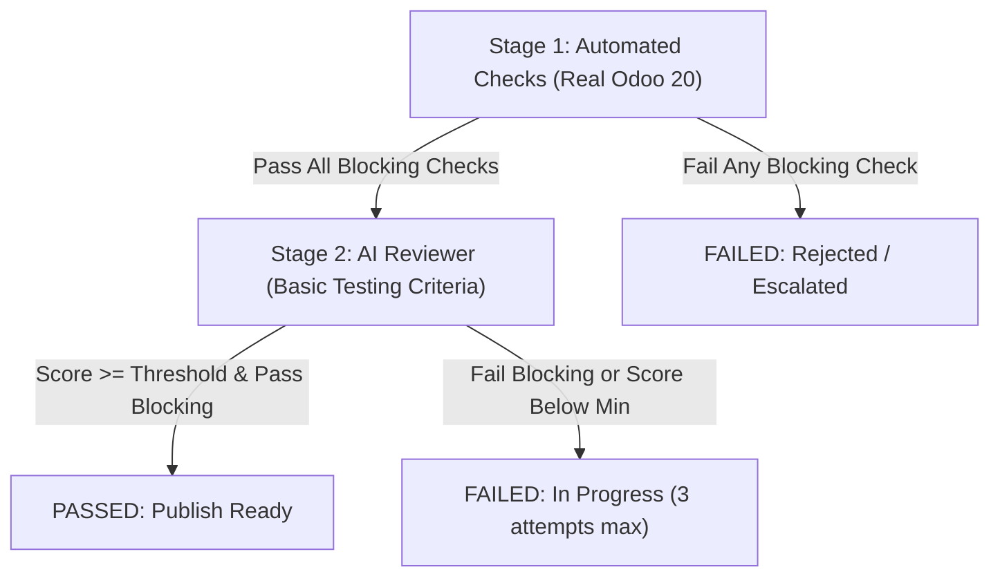
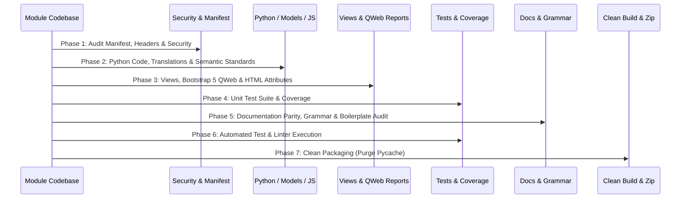

# Odoo 20 Module Migration & First-Attempt AI Pass Playbook

This playbook establishes a standard operating procedure (SOP) to audit, migrate, test, and package any Odoo module for Odoo 20 to score **100/100** and pass the Cybrosys AI Review on the first attempt.

---

## 1. Automated Checks & AI Review Scoring System

The Cybrosys review is conducted in two sequential stages:



### Stage 1: Automated Checks (Blocking)
* **Zip and Manifest Valid**: Manifest syntax, valid version (`20.0.1.0.0`), valid license (`LGPL-3`), installable is `True`.
* **Clean Dual-Installation (With & Without Demo Data)**: The module must install cleanly and pass all tests in **BOTH** environments:
  1. On a fresh database strictly **WITHOUT** demo data (`--without-demo=all`).
  2. On a fresh database **WITH** demo data.
* **Unit Tests Pass (Double Weight)**: At least one test file in `tests/`, tagged `@tagged('post_install', '-at_install')`, **0 errors, 0 failures** across both environments.
* **100% Public Method & Action Coverage**: Every public model method, compute method, constraint, button action (`action_*`), and wizard print/submit action must have a dedicated test case.
* **Code Linters**: `pylint-odoo` reports **0 errors and 0 warnings** (strictly 0 `W8113` redundant string warnings), and `ruff` reports 0 errors.

### Stage 2: AI Reviewer (Criteria 1.1 – 6.3)
* **Structure & Manifest**: Exact `depends`, all files referenced exist, no dead assets.
* **Criterion 1.5: No Missing, Unused or Duplicate Files (Blocking - Score Penalty down to 40/100)**:
  - **Mandatory Deprecation of `security/ir.model.access.csv` in Odoo 20**:
    In Odoo 20, the legacy access control file `security/ir.model.access.csv` is completely deprecated and replaced by `security/ir.access.csv`.
    - If `security/ir.model.access.csv` is present in the repository or still referenced in `__manifest__.py`, the reviewer awards a failing **40/100** score on Criterion 1.5 (*"security/ir.model.access.csv is used instead of security/ir.access.csv, which is deprecated in Odoo 20"*).
    - **Resolution**: Permanently delete `security/ir.model.access.csv` (`rm security/ir.model.access.csv`) and migrate all access rules into `security/ir.access.csv`. Update `'data'` in `__manifest__.py` to load `'security/ir.access.csv'`.
  - No orphaned XML, JS, or image files that are not referenced in the manifest or code.
* **Mandatory File Header**: **EVERY** Python file must contain the exact Cybrosys LGPL-3 header.
* **Criterion 4.1: Coding Standards & Modernization (Blocking - Score Penalty down to 40/100)**:
  - **Required Unified Access Control File (`security/ir.access.csv`)**:
    - In Odoo 20, using `security/ir.model.access.csv` instead of `security/ir.access.csv` is considered an outdated coding pattern and triggers a blocking **40/100** score under Criterion 4.1 (*"ir.model.access.csv is used instead of ir.access.csv which is required in Odoo 20"*).
    - Note the **Dual-Criterion Blocking Penalty**: retaining `ir.model.access.csv` penalizes **both** Criterion 1.5 (obsolete file) and Criterion 4.1 (outdated coding standard).
    - The module must strictly use the unified 6-column format in `security/ir.access.csv`: `id,name,model_id:id,group_id:id,operation,domain`.
  - **PEP8 & Multi-Record Safety**: PEP8 (no ambiguous variables like E741 `l`, `O`, `I`), multi-record safe methods, loop inside `@api.constrains`.
  - **SQL Injection Prevention**: Regex identifier validation (`^[A-Za-z0-9_]+$`), backtick/quote escaping, parameterized queries.
  - **Field Type Mapping Casing**: Exact lowercase `'many2one'` (never uppercase `'Many2one'`).
  - **Semantic Field Labels & Redundant Strings (W8113)**: Omit `string=` when matching default computed title.
  - **Views & QWeb**: Bootstrap 5 classes (`table-sm`), no obsolete HTML attributes (`align`), `<tree>` converted to `<list>`.
* **Criterion 4.2: Models, Views, Security and Data (Blocking - Score Penalty down to 40/100)**:
  - **Mandatory XML ID Format for `model_id:id` (Blocking Rule)**:
    - In `security/ir.access.csv`, the model reference column header **MUST** be `model_id:id` (with `:id` suffix) and its value **MUST** strictly reference the model's XML ID: `model_<technical_name_underscored>` (e.g. `model_undo_redo`).
    - **NEVER** use raw technical dot-notation model names (e.g. `undo.redo`) in `ir.access.csv`. Referencing raw dot-notation triggers an automatic blocking **40/100** score under Criterion 4.2 (*"security/ir.access.csv references model_id as '<model_name>' instead of the proper XML ID format"*).
  - **Security Groups Header**: Group references column header **MUST** be `group_id:id` (e.g. `undo_redo.group_undo_redo_user`, `base.group_user`).
  - **Complete Model Coverage**: Every single model (`models.Model`) and transient model / wizard (`models.TransientModel`) MUST have an access row in `security/ir.access.csv`.
  - **Strict Least Privilege**: Infrastructure, database connector, and credential models must be restricted to `base.group_system`, not `base.group_user`. Sensitive password/secret fields must specify `groups="base.group_system"`. Audit log and synchronization models must have complete views and menus.
* **Criterion 4.3: No Debug or Deprecated Code (Blocking - Score Penalty down to 40/100)**:
  - **Zero Debug Artifacts**:
    - Absolute prohibition against `print()` statements in Python and `console.log()` / `debugger;` in JavaScript.
    - Zero `breakpoint()`, `import pdb`, `pdb.set_trace()`, or `import ipdb`.
    - Zero commented-out code lines (e.g. `# print(...)`, `# record.write(...)`, `# field = fields.Char(...)`).
    - An AI Reviewer LLM triggers a blocking **40/100** score on Criterion 4.3 (*"Contains debug code (print statements and commented-out lines) in <file>"*) if any debug stubs, commented code, or uncleaned hooks are detected.
  - **Hook Cleanliness & Docstring Requirement**:
    - Files like `hooks.py` must define clean docstrings immediately following `def post_init_hook(env):` and `def uninstall_hook(env):`.
    - Never leave blank empty lines between `def hook(...)` and its first statement.
    - Never use blind exception suppression (`except Exception: pass`) in hooks or models; always catch specific exceptions and log with `_logger.warning(...)` or `_logger.exception(...)`.
  - **Whitespace & Formatting Hygiene**:
    - Zero trailing whitespace and zero raw tabs (`\t`) in `.py`, `.js`, `.xml`, or `.csv` files.
    - Clean standard 4-space indentation across all Python logic.
* **Deprecated APIs**: Zero Odoo 16/17/18/19 deprecated code (including legacy `security/ir.model.access.csv`).
* **Doc-to-Code Parity & Grammar (6.3)**: `index.html`, `README.rst`, and `RELEASE_NOTES.md` match actual code. No false claims in FAQs, no template boilerplate leftovers (e.g. `#cybrosys-acc-kit`), proper English grammar (no "allows to + verb"), singular/plural consistency, and synchronized release dates.
* **No Junk (6.2 - Blocking)**: Zero `__pycache__`, `.pyc`, backup files, or unused assets in the archive or directory.

---

## 2. Mandatory Python File Header (All `.py` Files)

Every Python file across the module (including `__init__.py`, `__manifest__.py`, `models/*.py`, `wizard/*.py`, `controllers/*.py`, `report/*.py`, and `tests/*.py`) **MUST** start with this exact header:

```python
# -*- coding: utf-8 -*-
#############################################################################
#
#    Cybrosys Technologies Pvt. Ltd.
#
#    Copyright (C) 2026-TODAY Cybrosys Technologies(<https://www.cybrosys.com>)
#    Author: Cybrosys Techno Solutions(<https://www.cybrosys.com>)
#
#    You can modify it under the terms of the GNU LESSER
#    GENERAL PUBLIC LICENSE (LGPL v3), Version 3.
#
#    This program is distributed in the hope it will be useful,
#    but WITHOUT ANY WARRANTY; without even the implied warranty of
#    MERCHANTABILITY or FITNESS FOR A PARTICULAR PURPOSE.  See the
#    GNU LESSER GENERAL PUBLIC LICENSE (LGPL v3) for more details.
#
#    You should have received a copy of the GNU LESSER GENERAL PUBLIC LICENSE
#    (LGPL v3) along with this program.
#    If not, see <http://www.gnu.org/licenses/>.
#
#############################################################################
```

### Automated Header Audit & Insertion Script
Run this script to instantly check and report/fix missing headers in any module:

```bash
python3 -c "
import os

HEADER = '''# -*- coding: utf-8 -*-
#############################################################################
#
#    Cybrosys Technologies Pvt. Ltd.
#
#    Copyright (C) 2026-TODAY Cybrosys Technologies(<https://www.cybrosys.com>)
#    Author: Cybrosys Techno Solutions(<https://www.cybrosys.com>)
#
#    You can modify it under the terms of the GNU LESSER
#    GENERAL PUBLIC LICENSE (LGPL v3), Version 3.
#
#    This program is distributed in the hope it will be useful,
#    but WITHOUT ANY WARRANTY; without even the implied warranty of
#    MERCHANTABILITY or FITNESS FOR A PARTICULAR PURPOSE.  See the
#    GNU LESSER GENERAL PUBLIC LICENSE (LGPL v3) for more details.
#
#    You should have received a copy of the GNU LESSER GENERAL PUBLIC LICENSE
#    (LGPL v3) along with this program.
#    If not, see <http://www.gnu.org/licenses/>.
#
#############################################################################
'''

module_path = '.'
for root, _, files in os.walk(module_path):
    if '__pycache__' in root:
        continue
    for f in files:
        if f.endswith('.py'):
            p = os.path.join(root, f)
            with open(p, 'r', encoding='utf-8') as fh:
                content = fh.read()
            if 'Cybrosys Technologies Pvt. Ltd.' not in content:
                print(f'[MISSING HEADER] Fixing: {p}')
                with open(p, 'w', encoding='utf-8') as fh:
                    fh.write(HEADER + content.lstrip())
            else:
                print(f'[OK] {p}')
"
```

---

## 3. Phase-by-Phase Module Migration Plan



---

### Phase 1: Manifest, Dependencies & Security (Section 3.1 & 4.2)

1. **Manifest File (`__manifest__.py`)**:
   - `version`: `'20.0.1.0.0'`
   - `license`: `'LGPL-3'`
   - `author` & `company`: `'Cybrosys Techno Solutions'`
   - `maintainer`: `'Cybrosys Techno Solutions'`
   - `website`: `'https://www.cybrosys.com'`
   - `images`: `['static/description/banner.jpg']`
   - **Summary formatting**: Exactly one grammatically correct sentence ending with a period.
   - **Narrow Dependencies**:
     - Do NOT include `'base'` if other modules (like `'sale'`, `'hr_timesheet'`, etc.) are listed.
     - Only list modules whose models, fields, or XML records are directly used.
     - Declare third-party Python packages in `'external_dependencies': {'python': [...]}`.
   - **Load Order in `'data'`**:
     1. Security groups (`security/<name>_groups.xml`)
     2. Access rules (`security/ir.access.csv` — **NEVER** `security/ir.model.access.csv`!)
     3. Data records / sequences (`data/...`)
     4. Views (`views/..._views.xml`)
     5. Wizards (`wizard/..._views.xml`)
     6. Reports and Templates (`report/..._reports.xml`, `report/..._templates.xml`)
     7. Menus (`views/..._menu_views.xml`)

2. **Security Access Migration: `ir.model.access.csv` ➔ `ir.access.csv` (Criterion 1.5 & 4.2)**:
   > [!IMPORTANT]
   > **Odoo 20 Security Architecture Change**:
   > In Odoo 20, `ir.model.access` and `ir.rule` have been unified into `ir.access`. The legacy access control file `security/ir.model.access.csv` is **completely deprecated** and triggers an immediate AI Review failure (40/100 on Criterion 1.5).
   > You must migrate all ACL entries into `security/ir.access.csv` and permanently delete `security/ir.model.access.csv`.

   - **Schema Differences**:
     - **Legacy Odoo 16/17/18/19 (`ir.model.access.csv`) — 8 columns**:
       ```csv
       id,name,model_id:id,group_id:id,perm_read,perm_write,perm_create,perm_unlink
       access_undo_redo,undo.redo,model_undo_redo,base.group_user,1,1,1,1
       ```
     - **Odoo 20 Standard (`ir.access.csv`) — 6 columns**:
       ```csv
       id,name,model_id:id,group_id:id,operation,domain
       access_undo_redo,access.undo.redo,model_undo_redo,base.group_user,crud,
       ```

   - **Column Conversion Mapping Table**:
     | Legacy Header (`ir.model.access.csv`) | Odoo 20 Header (`ir.access.csv`) | Notes / Transformation |
     |---|---|---|
     | `id` | `id` | Unique XML ID (e.g. `access_my_model`) |
     | `name` | `name` | Descriptive name (e.g. `access.my.model`) |
     | `model_id:id` | `model_id:id` | **Strict XML ID format** (`model_<technical_name_underscored>`, e.g. `model_undo_redo`). **CRITICAL (Criterion 4.2)**: Do NOT strip `model_` or use raw dot notation (`undo.redo`). Raw dot notation triggers a blocking 40/100 failure under Criterion 4.2! |
     | `group_id:id` | `group_id:id` | External group XML ID (e.g. `base.group_user`, `<module>.<group_name>`, or leave blank for global) |
     | `perm_read,perm_write,perm_create,perm_unlink` | `operation` | Combination of active permission characters: `c` (create), `r` (read), `u` (update/write), `d` (delete/unlink). Full CRUD `1,1,1,1` = `crud`; Read-only `1,0,0,0` = `r`; Read/Write `1,1,0,0` = `ru`. |
     | *(new column)* | `domain` | Optional domain rule string (e.g. `[('company_id', 'in', company_ids)]`) or leave empty for unrestricted model access. |

   - **Automated CSV Migration Script**:
     To convert any existing legacy `security/ir.model.access.csv` to `security/ir.access.csv`:
     ```bash
     python3 -c "
     import csv, os

     old_p = 'migration/<technical_name>/security/ir.model.access.csv'
     new_p = 'migration/<technical_name>/security/ir.access.csv'
     if os.path.exists(old_p):
         with open(old_p, 'r', encoding='utf-8') as f_in, open(new_p, 'w', encoding='utf-8', newline='') as f_out:
             reader = csv.DictReader(f_in)
             writer = csv.writer(f_out)
             writer.writerow(['id', 'name', 'model_id:id', 'group_id:id', 'operation', 'domain'])
             for row in reader:
                 mid = row.get('model_id:id') or row.get('model_id', '')
                 # Ensure proper XML ID format 'model_<name_with_underscores>'
                 if not mid.startswith('model_'):
                     mid = f'model_{mid.replace(\".\", \"_\")}'
                 gid = row.get('group_id:id') or row.get('group_id/id', '')
                 ops = ''
                 if row.get('perm_create') in ('1', 1): ops += 'c'
                 if row.get('perm_read') in ('1', 1): ops += 'r'
                 if row.get('perm_write') in ('1', 1): ops += 'u'
                 if row.get('perm_unlink') in ('1', 1): ops += 'd'
                 writer.writerow([row.get('id', ''), row.get('name', ''), mid, gid, ops, ''])
         os.remove(old_p)
         print(f'[MIGRATED] Converted {old_p} -> {new_p} with model_id:id XML ID format and removed legacy file.')
     else:
         print('[OK] No legacy ir.model.access.csv found.')
     "
     ```

   - **Strict Enforcement & Least Privilege (4.2)**:
     - Every single model (`models.Model`) **and wizard** (`models.TransientModel`) MUST have an access row in `security/ir.access.csv`.
     - Manifest `'data'` list MUST load `'security/ir.access.csv'`, NEVER `'security/ir.model.access.csv'`.
     - **Least Privilege for Infrastructure & Credential Modules**:
       - Never grant `base.group_user` CRUD permissions on external database credentials, API secrets, or synchronization runners.
       - Infrastructure, connector, and credential models must be restricted to `base.group_system`.
       - Align ACL groups with menu security: if menus require `base.group_system`, model access must not be left open to all internal users (`base.group_user`) via RPC.
     - **Sensitive Credential Protection (`groups="base.group_system"`)**:
       - Password, private key, and API secret fields (e.g. `password = fields.Char(...)`) must declare `groups="base.group_system"`.
       - This guarantees that non-system users cannot inspect credentials through client RPC read calls.
     - Never leave models accessible to public users unless specifically required and secured.
     - `security/ir.model.access.csv` MUST be permanently deleted from disk and git.

---

### Phase 2: Python Code & Coding Standards (Section 4.1 & 4.3)

#### Coding Standards & Semantic Integrity Checklist
- **Headers**: Verify mandatory Cybrosys LGPL-3 header on every file.
- **Line Length**: Max 120 characters for code, max 79 for docstrings/comments.
- **Imports**: No double spaces in imports; group standard library first, then third-party, then Odoo.
- **Docstrings**: One clear explanatory docstring on every class and public method.
- **Semantic Field Labels & Elimination of Redundant `string` Attributes (`pylint-odoo` W8113 - Zero Tolerance)**:
  - **Odoo Automatic Field Label Derivation**:
    - Odoo's ORM automatically computes human-readable field labels if `string` is omitted:
      - Standard fields: `name.replace('_', ' ').title()` (e.g. `table_name` ➔ `"Table Name"`, `updated_data` ➔ `"Updated Data"`, `mode` ➔ `"Mode"`).
      - Relational `_id` fields: `name[:-3].replace('_', ' ').title()` (e.g. `user_id` ➔ `"User"`, `partner_id` ➔ `"Partner"`, `company_id` ➔ `"Company"`).
  - **The Golden Rule for `W8113`**: **NEVER supply `string=` if the string value matches the field's default computed label!**
    - ✗ `table_name = fields.Char(string="Table Name")` ➔ **Flags W8113!** Correct: `table_name = fields.Char()`
    - ✗ `updated_data = fields.Json(string="Updated Data")` ➔ **Flags W8113!** Correct: `updated_data = fields.Json()`
    - ✗ `mode = fields.Selection([('undo', 'Undo')], string="Mode")` ➔ **Flags W8113!** Correct: `mode = fields.Selection([('undo', 'Undo')])`
    - ✗ `user_id = fields.Many2one('res.users', string="User")` ➔ **Flags W8113!** Correct: `user_id = fields.Many2one('res.users')`
    - ✗ `partner_id = fields.Many2one('res.partner', string="Partner")` ➔ **Flags W8113!** Correct: `partner_id = fields.Many2one('res.partner')`
  - **Harmonizing Semantic Parity with W8113**:
    - Semantic label parity exists to stop **misleading or mismatched** labels (e.g. writing `user_id = fields.Many2one('res.users', string='Employee')` or `employee_id = fields.Many2one('hr.employee', string='User')`).
    - If the field name already represents the target model (e.g. `user_id` pointing to `res.users`, or `partner_id` pointing to `res.partner`), **omit `string=` entirely**. Odoo automatically sets `"User"` or `"Partner"`, avoiding both semantic mismatch AND `W8113`.
    - **Only** supply `string="..."` when the label must be customized to differ from the auto-generated title-cased name, for example:
      - `responsible_id = fields.Many2one('res.users', string="Responsible User")` (default would have been `"Responsible"`).
      - `start_date = fields.Date(string="Starting Date")` (customized from default `"Start Date"`).
- **Grammar in Field Labels & Help Texts**:
  - Singular vs Plural: If a wizard field selects a single date, write `'Starting Date'`, NOT `'Starting Dates'`.
  - Help text: Write `'Choose the starting date.'`, NOT `'Choose the starting dates.'`.
- **Naming Conventions**:
  - Model `_name` must have the module prefix (e.g. `timesheets_by_employee.report`, not generic `report`).
  - Private methods start with `_` (e.g. `_compute_*`, `_onchange_*`, `_check_*`).
  - No single letter or ambiguous variables (E741: never use `l`, `O`, `I`; e.g. use `for key, label in selection_options:`).
  - No SQL reserved words as field names (`group`, `user`, `order`, `select`).
- **External Database Queries & SQL Injection Prevention**:
  - Never construct SQL queries via raw f-string interpolation or string concatenation of user-entered table names, column names, or filter values (`f"SELECT * FROM {self.sql_table}"`).
  - Validate all external database identifiers (table names, column names) against a strict regex whitelist (`^[A-Za-z0-9_]+$`) via `@api.constrains` and helper validation before execution.
  - Quote validated identifiers appropriately (e.g., backticks `` `table` `` for MySQL or double quotes `"` for PostgreSQL).
  - Parameterize all WHERE clauses, filters, and metadata queries (e.g., `INFORMATION_SCHEMA.KEY_COLUMN_USAGE` filtering `TABLE_SCHEMA = %s AND TABLE_NAME = %s AND COLUMN_NAME = %s`) using parameter tuples (`cursor.execute(query, params)`).
- **Field Type Mapping Casing (`ttype` match)**:
  - Odoo model field types (`ir.model.fields.ttype`) are strictly lowercase (`'many2one'`, `'one2many'`, `'many2many'`, `'integer'`, `'char'`, `'boolean'`, `'selection'`, `'float'`).
  - Relational mapping dictionaries must use exact lowercase `'many2one'` (never uppercase `'Many2one'`). Uppercase values cause valid relational/foreign type conversions to fail.
- **Multi-Record Safety**:
  - `@api.constrains`: Always loop `for record in self:`. Never assign values inside constraints.
  - Action methods expecting a single record must call `self.ensure_one()`.
  - Action return dictionaries must have python dict contexts (e.g. `'context': {'create': False}`).
- **Translatable Strings & Translations**:
  - Use `self.env._()` inside model methods (preferred in modern Odoo 18+) or `_()` from `odoo`:
    ```python
    raise UserError(self.env._("Start date must be earlier than or equal to end date."))
    ```
  - Use named placeholders: `self.env._("Order %(name)s confirmed", name=self.name)`.
  - Never use positional `%s` formatting with `_()` or `self.env._()`.
- **Exceptions**:
  - No blind `except Exception: pass`. Catch specific errors, log with `_logger.exception` or `_logger.warning`, and raise translated `UserError` or `ValidationError`.
- **Cleanliness & Criterion 4.3 (No Debug or Deprecated Code - Blocking)**:
  - Zero `print()`, `console.log()`, `pdb`, `breakpoint()`, or `TODO`/`FIXME` comments.
  - Zero commented-out lines of code across all files (never leave `# my_code = 123` or `# print(...)`).
  - All hooks (`hooks.py`) and utility files must have clean docstrings on all functions, no floating empty lines before statements, and proper error handling.
  - Zero trailing whitespace and zero raw tabs (`\t`) in `.py`, `.js`, or `.xml` files.

#### Odoo 20 Deprecated API Migrations

| Old / Deprecated Pattern | Odoo 20 Standard Pattern | Reason / Pitfall Avoided |
|---|---|---|
| `security/ir.model.access.csv` (8-column legacy format) | `security/ir.access.csv` (6-column unified format: `id,name,model_id:id,group_id:id,operation,domain`) | Completely deprecated in Odoo 20. Triggers multi-criterion blocking penalty: fails Criterion 1.5 (40/100) and Criterion 4.1 Coding Standards (40/100). Furthermore, `model_id:id` MUST use the proper XML ID format (`model_<technical_name>`); using raw dot-notation (e.g. `undo.redo`) triggers a blocking 40/100 failure under Criterion 4.2. Must be converted to `ir.access.csv` with XML ID format and legacy CSV permanently deleted. |
| `'security/ir.model.access.csv'` in manifest `'data'` | `'security/ir.access.csv'` in `'data'` | Manifest must reference the new unified `ir.access.csv` file. |
| `fields.Date.today()` | `fields.Date.context_today(self)` | `today()` ignores the user's timezone; `context_today(self)` is timezone-aware. |
| `def create(self, vals):` iterating `vals` | `def create(self, vals_list):` handle both list and dict: `vals_list = [vals_list] if isinstance(vals_list, dict) else vals_list` or call `super().create(vals_list)` | In Odoo, `create` receives a list of dicts for batch creation or a dict in test calls. Iterating a dict iterates its keys and crashes! |
| `@api.constrains(...)`<br>`def _check(self):` without loop | `for record in self:` inside every constraint | Constraints must be multi-record safe. Never assign values inside a constraint. |
| `_sql_constraints = [...]` | `models.Constraint(...)` | `_sql_constraints` is completely deprecated in Odoo 20. |
| `groups_id` on `res.users` | `group_ids` | `groups_id` was renamed to `group_ids`. Using `groups_id` causes `KeyError` or install crash. |
| `self._cr`, `self._context` | `self.env.cr`, `self.env.context` | Internal attributes are deprecated. |
| `ir.attachment.create({'datas': b64})` | `ir.attachment.create({'raw': base64.b64decode(b64)})` | `datas` has been removed from `ir.attachment` in Odoo 20 and emits a `UserWarning`. |
| Dynamic SQL joins without aliases (`JOIN rel_table ON ...`) | `JOIN rel_table AS rel_alias ON ...` | Self-referencing fields throw PostgreSQL `DuplicateAlias: table name specified more than once`. |
| Redundant `string` on fields (`name = fields.Char(string='Name')`, `table_name = fields.Char(string='Table Name')`, `user_id = fields.Many2one('res.users', string='User')`, `mode = fields.Selection(..., string='Mode')`) | `name = fields.Char()`, `table_name = fields.Char()`, `user_id = fields.Many2one('res.users')`, `mode = fields.Selection(...)` | Fails `pylint-odoo` W8113 (`attribute-string-redundant`). Odoo automatically title-cases regular field names and strips `_id` on relational fields. Omit `string=` unless the label intentionally differs from the auto-generated title. |
| Function default without lambda (`default=self.foo`) | `default=lambda self: self.foo()` | Fails `pylint-odoo` E8148 (breaks inheritability). |
| Two fields sharing the exact same string label | Differentiate string labels (e.g. `model_name` string="Model Technical Name") | Triggers registry warning `Two fields have the same label`. |
| `base.group_user` CRUD on database credentials | Restrict to `base.group_system` in `ir.access.csv` | Allows any internal user to read credentials or run sync via RPC. |
| Sensitive password/token field without `groups` | `password = fields.Char(groups='base.group_system')` | Exposes plaintext credentials over RPC to unprivileged users. |
| Audit / Sync log model without views or menu | Provide list, form, search view, action, and menu | Orphaned models without UI fail audit section 4.2. |
| Phantom required field in XML view (e.g. `ref_col_name`) | Remove phantom field from view and model | Blocks record saves and fails view validation. |
| Dead / unused model field (e.g. `sync.table.unique`) | Purge dead field from model | Violates clean schema and code standards. |
| `<group expand="0">` in search view | `<group>` (remove obsolete `expand`) | Fails Odoo 20 RelaxNG view validation. |
| Raw f-string SQL query (`f"SELECT * FROM {self.table}"`) | Regex validate identifier (`^[A-Za-z0-9_]+$`), backtick quote (`` `table` ``), and parameterize filters (`cursor.execute(query, params)`) | Raw string interpolation opens external/internal databases to SQL injection. |
| Type mapping using `'Many2one'` | Lowercase `'many2one'` | Odoo `ir.model.fields.ttype` is `'many2one'`. Capitalized `'Many2one'` causes type validation errors on valid records. |
| Ambiguous variable name `l`, `O`, `I` (`for k, l in ...`) | Descriptive names: `for key, label in ...` | Violates PEP 8 / Flake8 / Ruff rule E741 (ambiguous variable name). |
| Monkey-patching `BaseModel` | Modular extension / inheritance | Fails coding standard review 4.1. |
| `type(x) == dict` | `isinstance(x, dict)` | Violates Python / Odoo coding conventions. |

---

### Phase 3: Views, XML, QWeb & Templates (Section 4.1 & 4.2)

1. **XML Views**:
   - `<tree>` -> `<list>`: Tree views must be declared with `<list>`.
   - Invisible attributes: Use Python boolean expressions `invisible="not field_name"` or `invisible="state != 'draft'"`. Never `invisible="field_name == False"`.
   - List columns visibility: Use `column_invisible="not ..."` instead of `invisible`.
   - Button styling: Replace obsolete `btn-default` with `btn-secondary`.
   - Wizard Footers: Never nest `<footer>` inside `<sheet>` or `<group>`. Put `<footer>` directly under `<form>`.
   - **Zero Phantom / Unused Fields**:
     - Never include fields in views that are marked required or editable but never populated or used by backend logic (e.g. `ref_col_name`).
     - Purge unused, dead model fields that have no backend or frontend utility (e.g. `unique = fields.Char(...)`).
   - **Audit Logs & History Views (Completeness Rule)**:
     - Any model designed to track execution history, audit logs, or synchronized records (`imported.data`) must provide:
       1. `<list>` view (e.g. `create="false" edit="false"`).
       2. `<form>` view (e.g. `create="false" edit="false"`).
       3. `<search>` view with search fields and group-by filters.
       4. Window action (`ir.actions.act_window`) and an accessible menuitem.
   - **Search View RNG Standards**:
     - Never use obsolete `expand="0"` attribute on `<group>` in `<search>` views; it causes RelaxNG validation errors.
     - Always provide a `string` attribute on `<search string="...">`.

2. **Bootstrap 5 & Modern HTML in QWeb Reports**:
   - **Bootstrap 3 -> Bootstrap 5 Classes**:
     - `table-condensed` ➔ **`table-sm`** (Bootstrap 3 `table-condensed` is obsolete and flagged as an error!).
     - `panel`, `panel-default` ➔ `card`, `card-body`.
     - `pull-right`, `pull-left` ➔ `float-end`, `float-start`.
   - **No Obsolete HTML Presentation Attributes**:
     - `<h2 align="center">` ➔ **`<h2 class="text-center">`** (HTML `align` attribute is obsolete in HTML5 and flagged!).
     - `<td align="right">` ➔ **`<td class="text-end">`** (or `style="text-align: right;"`).
     - `<table width="100%">` ➔ **`<table class="w-100">`**.

3. **OWL JavaScript Components**:
   - Modern syntax: Use standard ES6 classes extending `Component`.
   - Never use `var self = this;` — use arrow functions `() => {}` or method binding.
   - Services: Use `useService("rpc")`, `useService("action")`, `useService("notification")` instead of deprecated direct calls or undefined `self.rpc`.
   - No direct DOM manipulation: Use OWL refs (`useRef`) and reactive state instead of `document.getElementById` or jQuery `$`.

4. **Static Assets & HTML Description (`static/description/`)**:
   - Purge draft files: Delete any temporary files (e.g., `index1.html`, unreferenced mockups/draft images).
   - Container IDs: Replace copy-pasted container IDs (e.g., `#cybrosys-acc-kit`) with module-specific IDs (e.g., `#<technical_name>`).

---

### Phase 4: Unit Test Suite & Coverage (Section 5)

> [!IMPORTANT]
> **Tests are blocking and carry double weight.** Any module submitted without tests automatically fails Stage 1.

1. **Folder & Structure**:
   ```
   tests/
   ├── __init__.py
   └── test_<main_feature>.py
   ```
2. **Tagging**:
   Always tag test classes with:
   ```python
   @tagged('post_install', '-at_install')
   class TestModuleName(TransactionCase):
   ```
3. **100% Public Method & Action Coverage**:
   - Every public model method, compute method, constraint, button action (e.g., `action_*`), and wizard execute/print method must have a dedicated test case.
   - Test both successful execution and negative validation/UserError raises.
4. **Preventing `NotNullViolation` & Field Errors**:
   - Inspect all model definitions for `required=True` before writing tests.
   - Every `create()` call in tests MUST include all required fields.
5. **Asserting Correct Titles and Content**:
   - If asserting report titles in tests, verify that the string matches the **grammatically correct singular/plural** form (e.g. `'Timesheet Report by Employee'`, not `'Timesheet Report by Employees'`).
6. **Coverage Target**:
   - Test the happy path, edge cases, error conditions, date validations, and constraints.
   - Ensure statement coverage of `models/`, `wizard/`, and `report/` is **>= 80%**.

---

### Phase 5: Documentation Parity, Grammar & Content Audit (Section 1.4, 2 & 6.3)

> [!CAUTION]
> AI Reviewer penalizes heavily for grammar errors, template boilerplate leftovers, and mismatched claims across documentation.

1. **Grammar & Phrasing Rules**:
   - **Never write "allows to [verb]"**:
     - ✗ *"This module allows to print the timesheet of selected employee"*
     - ✓ *"This module allows users to print the timesheet of the selected employee."* OR *"This module allows printing the timesheet of the selected employee."*
   - **Singular vs Plural Precision**:
     - If the module filters/prints for **one** employee:
       - Report Title: `'Timesheet Report by Employee'` (singular), NOT `'Timesheet Report by Employees'`.
       - Text: `'timesheet of the selected employee'`, NOT `'timesheet of selected employees'`.
       - Wizard labels/help: `'Starting Date'`, NOT `'Starting Dates'`.

2. **Elimination of Template Boilerplate Leftovers**:
   - Search `index.html` and `README.rst` for copy-paste artifacts from other Cybrosys apps:
     - ✗ *"chart of accounts migrations"*, *"core accounting operations"*, *"manage balance sheet"*, etc., in a timesheet or HR module!
     - ✗ Misplaced features in FAQs: e.g. claiming *"tasks performed"* if tasks are not part of the module data/report.
   - Check every single question and answer in the FAQ section of `index.html` against actual functionality.

3. **Brand & Capitalization Consistency**:
   - Proper noun casing must be consistent across the entire document:
     - Always use **`WhatsApp`** (capital 'A'), never `"Whatsapp"` and `"WhatsApp"` mixed together.
     - Always write **`Odoo 20`** (with a space), never `"Odoo20"`.

4. **Date Synchronization Across All Files**:
   - Check the date in `doc/RELEASE_NOTES.md` (e.g. `2026-10-19`).
   - Check the date/badge in `static/description/index.html` (e.g. badge saying `'Sep 2026'` vs release notes saying `2026-10-19`).
   - **The release month/year in `index.html` MUST match `doc/RELEASE_NOTES.md`!** (If release notes say October 2026, `index.html` must say October 2026).

5. **`README.rst` Formatting**:
   - Title underlined with `=====`.
   - Subsections (Installation, Usage, Credits, License, Maintainer) underlined with `-----` at the same heading level.
   - License must say `LGPL-3`.

6. **`doc/RELEASE_NOTES.md`**:
   - Format:
     ```markdown
     ## Module <technical_name>

     #### 2026-10-19
     #### Version 20.0.1.0.0
     #### ADD

     - Initial release for Odoo 20: <clear description>.
     ```

---

### Phase 6: Automated Verification & Test Commands

Before packaging, execute the following commands locally:

```bash
# 1. Clean test install & unit tests WITHOUT demo data (blocking)
/home/cybrosys/odoo20/.venv/bin/python /home/cybrosys/odoo20/odoo-bin -c odoo.conf \
    -d <db_no_demo> -i <technical_name> --without-demo=all --test-enable --test-tags <technical_name> --stop-after-init

# 2. Clean test install & unit tests WITH demo data (blocking)
/home/cybrosys/odoo20/.venv/bin/python /home/cybrosys/odoo20/odoo-bin -c odoo.conf \
    -d <db_with_demo> -i <technical_name> --test-enable --test-tags <technical_name> --stop-after-init

# 3. Verify No Deprecated ir.model.access.csv Exists or is Referenced (Criterion 1.5 - Blocking)
python3 -c "
import os, sys

base = 'migration/<technical_name>'
bad_files = []
for root, _, files in os.walk(base):
    for f in files:
        if f == 'ir.model.access.csv':
            bad_files.append(os.path.join(root, f))
if bad_files:
    print(f'[FAIL CRITERION 1.5] Found deprecated ir.model.access.csv: {bad_files}')
    sys.exit(1)

manifest_p = os.path.join(base, '__manifest__.py')
if os.path.exists(manifest_p):
    with open(manifest_p, 'r') as fh:
        content = fh.read()
    if 'ir.model.access.csv' in content:
        print('[FAIL CRITERION 1.5] __manifest__.py still references deprecated ir.model.access.csv!')
        sys.exit(1)

print('[OK] 0 ir.model.access.csv files/references found. Passed Criterion 1.5 check.')
"

# 4. Verify security/ir.access.csv Header and XML ID Format (Criterion 4.2 - Blocking)
python3 -c "
import csv, os, sys

base = 'migration/<technical_name>'
csv_p = os.path.join(base, 'security', 'ir.access.csv')
if not os.path.exists(csv_p):
    print(f'[WARN] No security/ir.access.csv found at {csv_p}')
else:
    with open(csv_p, 'r', encoding='utf-8') as fh:
        reader = csv.reader(fh)
        header = next(reader, None)
        if not header:
            print(f'[FAIL CRITERION 4.2] {csv_p} is empty!')
            sys.exit(1)
        expected_header = ['id', 'name', 'model_id:id', 'group_id:id', 'operation', 'domain']
        if header != expected_header:
            print(f'[FAIL CRITERION 4.2] Header mismatch in {csv_p}!\nFound:    {header}\nExpected: {expected_header}')
            sys.exit(1)
        for line_no, row in enumerate(reader, start=2):
            if not row or not any(row):
                continue
            mid = row[2].strip()
            if not mid.startswith('model_') or '.' in mid:
                print(f'[FAIL CRITERION 4.2] Line {line_no} references model_id as {mid!r} instead of proper XML ID format (model_<technical_name>)!')
                sys.exit(1)
    print(f'[OK] security/ir.access.csv header and model_id:id XML IDs valid.')
"

# 5. Check for linter issues (pylint-odoo & ruff)
pylint --load-plugins=pylint_odoo --disable=all --enable=odoolint,attribute-string-redundant \
       --valid-odoo-versions=20.0 migration/<technical_name>

ruff check migration/<technical_name>

# 6. Local AST Audit Script for Redundant String Attributes (pylint-odoo W8113)
python3 -c "
import ast, os

def check_file(path):
    violations = 0
    with open(path, 'r', encoding='utf-8') as f:
        try:
            tree = ast.parse(f.read(), filename=path)
        except Exception:
            return 0
    for node in ast.walk(tree):
        if isinstance(node, ast.Assign):
            for target in node.targets:
                if isinstance(target, ast.Name) and isinstance(node.value, ast.Call):
                    call = node.value
                    is_field = False
                    if isinstance(call.func, ast.Attribute) and isinstance(call.func.value, ast.Name) and call.func.value.id == 'fields':
                        is_field = True
                    if is_field:
                        fname = target.id
                        for kw in call.keywords:
                            if kw.arg == 'string' and isinstance(kw.value, ast.Constant):
                                sval = kw.value.value
                                default_title = fname.replace('_', ' ').title()
                                rel_title = fname[:-3].replace('_', ' ').title() if fname.endswith('_id') else None
                                if sval == default_title or (rel_title and sval == rel_title):
                                    print(f'[W8113 REDUNDANT STRING] {path}:{kw.value.lineno}: {fname} has redundant string=\"{sval}\"')
                                    violations += 1
    return violations

base = 'migration/<technical_name>'
total_v = 0
for root, _, files in os.walk(base):
    for f in files:
        if f.endswith('.py'):
            total_v += check_file(os.path.join(root, f))
if total_v == 0:
    print('[OK] 0 W8113 redundant string attributes found.')
"

# 7. Verify No Debug Code, Commented Code, or Stray Tabs/Trailing Whitespace (Criterion 4.3 - Blocking)
python3 -c "
import os, sys

base = 'migration/<technical_name>'
violations = 0

for root, _, files in os.walk(base):
    for f in files:
        if f.endswith(('.py', '.js', '.xml', '.csv')):
            p = os.path.join(root, f)
            with open(p, 'r', encoding='utf-8') as fh:
                for line_no, line in enumerate(fh, 1):
                    # Check for trailing whitespace
                    if line.rstrip('\n') != line.rstrip():
                        print(f'[CRITERION 4.3] Trailing whitespace at {p}:{line_no}')
                        violations += 1
                    # Check for raw tabs
                    if '\t' in line:
                        print(f'[CRITERION 4.3] Tab character at {p}:{line_no}')
                        violations += 1
                    s = line.strip()
                    # Check for debug calls
                    if any(dbg in s for dbg in ['print(', 'console.log(', 'debugger;', 'breakpoint(', 'pdb.set_trace()', 'ipdb.set_trace()']):
                        print(f'[CRITERION 4.3] Debug statement at {p}:{line_no}: {s}')
                        violations += 1
                    # Check for commented-out Python code (ignoring mandatory 21-line license header)
                    if f.endswith('.py') and line_no > 21 and s.startswith('#'):
                        print(f'[CRITERION 4.3] Commented line at {p}:{line_no}: {s}')
                        violations += 1

if violations > 0:
    print(f'[FAIL CRITERION 4.3] Found {violations} debug / cleanliness violation(s)!')
    sys.exit(1)
print('[OK] Passed Criterion 4.3: Zero debug statements, commented code, or formatting flaws found.')
"

# 8. Check README rendering
python -m docutils migration/<technical_name>/README.rst > /dev/null
```

---

### Phase 7: Clean Packaging & Final Self-Review (Section 6.1 & 6.2)

> [!CAUTION]
> **Zero Junk Rule (6.2 - Blocking):** Running tests compiles bytecode (`__pycache__` and `.pyc`). You MUST run the purge commands immediately after testing. Even if the user requests to compress the zip manually, the module directory must be left completely purged of `__pycache__` and `.pyc`.

1. **Purge Junk Files (Mandatory across all module files)**:
   ```bash
   cd /home/cybrosys/odoo20/migration/<technical_name>
   find . -type d -name "__pycache__" -exec rm -rf {} +
   find . -type f -name "*.pyc" -delete
   find . -type f -name ".DS_Store" -delete
   find . -type f -name "*~" -delete
   ```

2. **Build Clean Archive (If building zip)**:
   ```bash
   cd /home/cybrosys/odoo20/migration
   zip -qr <technical_name>-20.0.1.0.0.zip <technical_name> \
       -x '*__pycache__*' '*.pyc' '*/.git/*' '*/.git' '*/.gitignore' '*.DS_Store' '__MACOSX/*'

   # Verify no junk got packaged (must return nothing)
   unzip -l <technical_name>-20.0.1.0.0.zip | grep -E 'pycache|\.pyc|\.git|DS_Store|__MACOSX' || echo "Clean: No junk found"
   ```
   *(Note: If the user chooses to compress manually, verify that the directory has 0 `__pycache__` or `.pyc` files before concluding the task).*

---

## 4. Module Migration Checklist (Copy for Every Task)

- [ ] **Technical Name & Structure**:
  - [ ] Name is lowercase `snake_case`.
  - [ ] All standard folders: `models/`, `views/`, `security/`, `static/description/`, `tests/`, `doc/`.
- [ ] **Mandatory Header & Standards (Section 2 & 4.1)**:
  - [ ] Every Python file has the exact Cybrosys LGPL-3 header with UTF-8 encoding.
  - [ ] **Unified Access Standard (Criterion 4.1 - Blocking)**: Uses `security/ir.access.csv` (never `security/ir.model.access.csv`); using legacy access CSV triggers an automatic 40/100 failure under Criterion 4.1.
  - [ ] Line length $\le 120$ characters.
  - [ ] No double spaces in imports.
  - [ ] Docstrings on all classes and public methods.
  - [ ] Translatable strings use `self.env._("... %(x)s", x=val)`.
  - [ ] Semantic label parity: `res.users` labeled 'User', `hr.employee` labeled 'Employee'.
  - [ ] **No redundant `string` attribute (`pylint-odoo` W8113)**: Omit `string=` when it matches the title-cased field name or stripped relational title (e.g. `user_id = fields.Many2one('res.users')`, NOT `string='User'`; `table_name = fields.Char()`, NOT `string='Table Name'`).
  - [ ] Singular/plural precision in labels and help texts (e.g. 'Starting Date', not 'Starting Dates').
  - [ ] **Criterion 4.3 No Debug or Deprecated Code (Blocking)**:
    - [ ] Strictly 0 `print()`, `console.log()`, `debugger;`, `breakpoint()`, `pdb.set_trace()`, or `TODO`/`FIXME`.
    - [ ] Zero commented-out lines of code across all `.py` and `.js` files.
    - [ ] Clean hook implementations (`hooks.py`): docstrings immediately following `def foo():`, zero floating empty lines, and no blind `except Exception: pass`.
    - [ ] Formatting hygiene: zero trailing whitespace and zero raw tabs (`\t`) in `.py`, `.js`, `.xml`, or `.csv` files.
- [ ] **Manifest & Security (Section 3.1 & 4.2)**:
  - [ ] Version `20.0.1.0.0`, license `LGPL-3`, author/maintainer `Cybrosys Techno Solutions`.
  - [ ] Summary is a single complete sentence ending with a period.
  - [ ] `depends` contains only strictly necessary modules (no superfluous `base`).
  - [ ] **`security/ir.model.access.csv` is DELETED** (Criterion 1.5 - Blocking): Deprecated in Odoo 20; 0 occurrences in module folder or git.
  - [ ] **`security/ir.access.csv` is USED (Criterion 4.1)**: Uses 6-column unified format (`id,name,model_id:id,group_id:id,operation,domain`).
  - [ ] **Criterion 4.2 Security XML ID Format (Blocking)**: `model_id:id` strictly references the model's XML ID format (`model_<technical_name_underscored>`, e.g. `model_undo_redo`), NEVER raw dot notation (e.g. `undo.redo`). Header must use `:id` suffix (`model_id:id`, `group_id:id`).
  - [ ] Manifest `'data'` list loads `'security/ir.access.csv'`, NEVER `'security/ir.model.access.csv'`.
  - [ ] Every model and wizard has an entry in `security/ir.access.csv`.
  - [ ] Least privilege enforced: infrastructure, connector, and credential models restricted to `base.group_system`.
  - [ ] Sensitive credential fields declare `groups="base.group_system"`.
- [ ] **Code Modernization (Odoo 20)**:
  - [ ] `fields.Date.context_today(self)` instead of `fields.Date.today()`.
  - [ ] `create(self, vals_list)` handles dict or list safely without crashing.
  - [ ] `@api.constrains` iterates over `self`.
  - [ ] No `_sql_constraints`; uses `models.Constraint`.
  - [ ] No `self._cr` or `self._context`; uses `self.env.cr`, `self.env.context`.
  - [ ] Attachments use `raw=...` instead of deprecated `datas=...`.
  - [ ] Dynamic SQL joins use unique table aliases.
  - [ ] No duplicate field label strings on the same model.
  - [ ] Lambda default on functions: `default=lambda self: self.get_default(...)`.
- [ ] **Views & QWeb Reports (Section 4.1 & 4.2)**:
  - [ ] `<tree>` converted to `<list>`.
  - [ ] `invisible` uses modern syntax (`invisible="not field"`).
  - [ ] Button styling uses `btn-secondary` instead of `btn-default`.
  - [ ] Wizard `<footer>` is direct child of `<form>`, outside `<sheet>`/`<group>`.
  - [ ] QWeb reports: `table-condensed` converted to `table-sm`.
  - [ ] QWeb reports: No obsolete `align="center"` / `align="right"`; uses `class="text-center"` / `class="text-end"`.
  - [ ] JS uses OWL services (`useService`), no `var self = this`, no direct DOM access.
- [ ] **Tests & Linters (Section 5)**:
  - [ ] Clean install & unit tests pass on fresh database **WITHOUT demo data** (`--without-demo=all`) with **0 failed, 0 errors**.
  - [ ] Clean install & unit tests pass on fresh database **WITH demo data** with **0 failed, 0 errors**.
  - [ ] Unit tests cover 100% of public model functions and actions.
  - [ ] Test record creation populates all `required=True` fields.
  - [ ] Title assertions in tests match the correct singular/plural report title.
  - [ ] `models/` code coverage is >= 80%.
  - [ ] `pylint-odoo` returns **0 errors and 0 warnings** (strictly 0 `W8113` redundant string warnings), and `ruff` returns 0 errors.
- [ ] **Documentation Parity & Grammar (Section 6.3)**:
  - [ ] No "allows to + verb" (use "allows users to + verb" or "allows + verb-ing").
  - [ ] Singular vs Plural: Report title and descriptions match single vs multiple records.
  - [ ] No boilerplate leftovers (e.g. accounting text in timesheets/HR modules).
  - [ ] FAQs accurately reflect actual module features only.
  - [ ] Brand casing consistent (e.g. "WhatsApp", not "Whatsapp").
  - [ ] Date synchronization: `index.html` month/year matches `RELEASE_NOTES.md`.
  - [ ] `README.rst` headings and license are properly formatted.
  - [ ] `doc/RELEASE_NOTES.md` has ISO date and "Odoo 20" title.
- [ ] **Packaging (Section 6.2)**:
  - [ ] Zero `__pycache__`, `.pyc`, `.gitkeep`, or unused asset files.
  - [ ] Zip named `<technical_name>-20.0.1.0.0.zip` with module folder at root.
